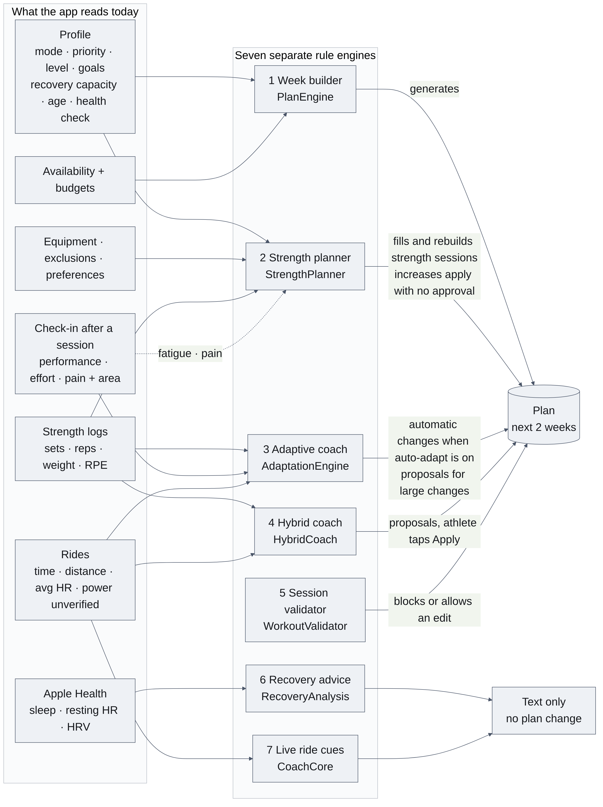
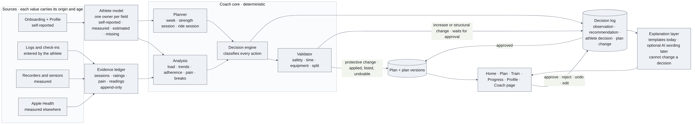
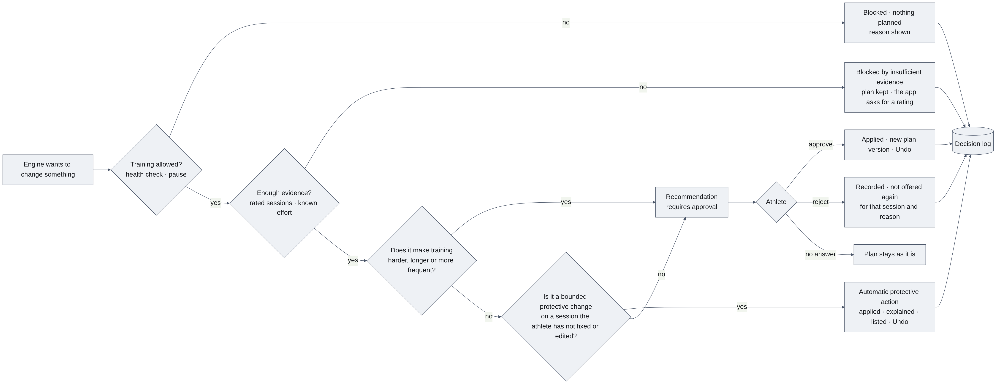
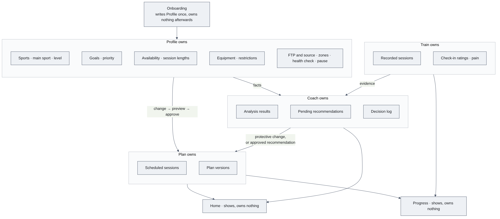

# Cyclift — AI Coach: Complete Architecture and Independent Audit

**15 Nov 2026 · Status: Architecture proposal — Pending Owner Review. Nothing in this document is approved, and nothing was implemented.** Read-only investigation of the app source at commit `4e2e9dc` (build-216 line). No code, test, data, CI run or configuration was changed; E0 runs 223 and 224 were not touched.

Evidence classes: **[EX]** a recorded test run exercised it (unit run 222, 659 tests, 0 failures; named suites given) · **[SRC]** read in source, not run by me · **[DES]** approved design direction only · **[PRO]** my proposal · **[UNK]** not verified.

**The one-paragraph answer.** Cyclift does not have one Coach. It has seven separate rule engines that grew at different times, three different kinds of "proposal", and no record of what the Coach decided in the past. The rules themselves are careful and honest (no AI model is used, and the app says so). The weaknesses are structural: increases reach the plan without approval through two paths, the Coach only thinks when the athlete rates a session, several inputs the screens collect are never read, and the approved Coach timeline cannot be built because decisions are not stored. The recommended architecture keeps the deterministic rules, puts one decision engine and one decision log in front of the plan, and leaves any AI to wording only — later, and only with your approval.

## A. Current Coach architecture audit

### A1. What exists: seven engines

| # | Engine (source file) | Job | Changes the plan? | Approval today | Evidence |
|---|---|---|---|---|---|
| 1 | Week builder (`Planning.swift`, PlanEngine) | Turns availability into the next two weeks: ride types, lift focus, easier weeks | Generates new weeks | None (generation) | [EX] HybridTests 11, HybridV2Tests 17 |
| 2 | Strength planner (`StrengthPlanner.swift`) | Picks exercises, sets, reps, loads, rests for coach-built sessions; rebuilds them after each log or check-in | Yes — rebuilds future sessions, **including heavier loads** | **None** | [EX] SupersetPipelineTests 10, StrengthAuditTests 11, AuditFixTests 17 |
| 3 | Adaptive coach (`AdaptationEngine.swift`, `AdaptiveStore.swift`) | After a check-in: fatigue, pain, missed sessions, progression | Yes — automatically when "Adjust future sessions automatically" is on (**default on**) | Only for large or over-budget changes | [EX] AdaptationEngineTests 15, CoachRemediationTests 35, Pass3 11 |
| 4 | Hybrid coach (`Hybrid.swift`, HybridCoach) | Weekly findings; proposals to move or soften a session that clashes | Only when the athlete taps Apply | Yes | [EX] HybridTests, HybridV2Tests |
| 5 | Session validator (`SessionRebuild.swift`) | Checks an edited or rebuilt session against 21 rules; blocks, adjusts or passes | Gatekeeper for edits (preview → Apply → Undo) | Yes | [EX] EngineSideEffectTests 6; **failing for no-equipment full-body (E0)** |
| 6 | Recovery advice (`RecoveryModel.swift`) | Compares sleep, resting heart rate and HRV with the athlete's own 28-day range | **No — text only** | n/a | [SRC]; suite not named in the capped log |
| 7 | Live ride cues (`Shared/CoachCore.swift`) | During a ride: "ease off", "pedal faster", against zone targets | No — cues only | n/a | [EX] CoachCoreTests 16 |

Around them: the health-check and return-from-break caps (`CoachSafety.swift`), the FTP suggestion (athlete must accept), and Home's one-line Coach texts. No language model, cloud service or external provider is called anywhere [SRC, whole-tree search].

### A2. The decision pipeline as it runs today [SRC]

1. **At launch and at midnight:** missing plan weeks are generated (engine 1), and future rides are capped for the health check or a return from a break. The adaptive coach does **not** run.
2. **When a strength session is saved:** engine 2 rebuilds all future coach-built strength sessions.
3. **When the athlete submits a check-in:** engine 2 rebuilds, then engine 3 analyses the last 35 days and applies or proposes changes. One "Undo" covers everything that check-in changed.
4. **When availability changes, a proposal is accepted, or pain is confirmed gone:** engine 3 runs again.
5. **When the athlete edits a session:** engine 5 validates; nothing is saved before Apply.

Consequence: **if the athlete stops rating sessions or stops training, the adaptive coach never runs.** Missed sessions are noticed only at the next check-in.

### A3. What the Coach reads — and what it does not

| Read today | Not read today (collected or shown, but used by no engine) |
|---|---|
| Check-in: performance 1–10, effort 1–10, pain level and one of five areas | Selected sports (`sports`) — read by nothing; there is no "main sport" |
| Strength logs: sets, reps, weight, per-set RPE | Power for load — **power is never marked verified** (`PowerTrust.meterVerified = false`, a constant), so every "verified power" rule is unreachable |
| Rides: date, minutes, average heart rate, planned-versus-done minutes | Sleep, resting heart rate, HRV — engine 6 only writes advice text |
| Profile: mode, priority, cycling level, strength experience, one cycling goal, strength goal, age, stated recovery capacity, health check, pause | Height, gender; cadence, distance and speed of rides |
| Availability, fixed days, weekly budgets | An event date — none exists in the model, although "Event" is a goal |
| Equipment, exclusions, avoided and preferred exercises, routines | Anything said before a session (how the athlete feels today) |

### A4. Every rule and threshold found [SRC — file names in the registry]

| Area | Rule as coded |
|---|---|
| Evidence needed | Fewer than 2 usable sessions in 14 days → low confidence, plan kept, the app asks for ratings |
| Fatigue flags (each needs two sessions in a row) | Effort ≥ baseline + 1.5 and performance ≤ baseline − 1.5 (baseline = own 4 weeks, else 6 / 7) · two sessions rated effort ≥ 9 · three sessions ≥ 9 in 7 days · two rides under 80 % of planned minutes · estimated 1RM under 95 % of own median twice |
| Fatigue response (next 7 days) | Next hard ride one zone easier (easy if two or more flags) · with two flags the next steady ride 10 % shorter · next strength session one set fewer (up to 4 exercises) |
| Load ratio | Last 7 days ÷ 4-week weekly average above 1.5 → information and an offer only, never automatic |
| Missed sessions | Two or more missed in 7 days → nothing is increased · half or more missed two weeks running → proposal "one session fewer per week" · never crammed into later days |
| Pain | Soreness: no change · Discomfort: that area is not progressed until a later clean session · Concerning: exercises loading that area are left out, hard ride eased, long rides 10 % shorter; **only the athlete can clear it**; the app asks after 7 days and two pain-free sessions of the same activity |
| Strength progression (two paths) | Two sessions in a row, every planned set done, RPE ≤ 8 → smallest weight step (cap 2.5 kg); else +1 rep (to 20); else +1 set (to 5) · Two failed sessions at RPE ≥ 9 → one rep fewer or lower load · No RPE logged → nothing increases |
| Strength dose | Reps and target RPE by goal and role (strength 4–6 @ 8 … general 6–10 @ 7); beginners capped at RPE 7 and ≥ 6 reps |
| Weekly sets per region | Beginner 8, intermediate 12, advanced 16 · × 0.7–0.85 balanced, × 0.5–0.6 cycling priority · × 1.1 muscle goal · × 0.75 legs in a heavy riding week · × 0.6 deload · × 0.7–1.1 age and recovery capacity |
| Rests | 60–180 s by role and goal, +30 s for older or slow-recovering athletes |
| Deload | Every 4th consecutive training week (3rd if age ≥ 60 or slow recovery), or when check-ins show fatigue |
| Ride week | One long ride (≥ 90 min), one quality ride (tempo for beginners and health goals, threshold for performance goals), VO2 added only for advanced performance riders with ≥ 4 rides · quality not beside a leg day when avoidable |
| Endurance progression | Threshold repetitions 3 → 4 → 5 across the block · easier week: no intervals, long ride 20 % shorter · after two good rated rides: +1 interval or +10 % minutes |
| Return after a break | Gap ≥ 21 days → loads × 0.95 / 0.9 / 0.8 / 0.7 by length of break; rides 85–60 % of usual time, steady only, for 3 sessions |
| Health check | "See a doctor" answers → no sessions · clearance pending → max zone 2, rides ≤ 120 min, strength RPE ≤ 6, ≥ 8 reps, no progression |
| Change bounds | ±1 rep, ≤ 2.5 kg, ±10 % duration per decision · planned load up > 10 % for a week → approval · over weekly budget or day limit → approval |
| FTP | 0.95 × best 20 minutes; offered only if ≥ 2 % different; applied only on Accept |

Several of these are marked in the code itself as "coaching heuristics, not evidence-derived" (pain 7-day prompt, break factors, 0.8 volume). They are reasonable but **no approved rule document exists** for them (see finding F-03).

### A5. The twelve questions, answered

| Question | Today |
|---|---|
| Workout generation | Rides: type and minutes from availability; steps built from the type. Strength: slots by focus → best available exercise → dose → load from the athlete's own logs only. [EX] |
| Strength progression | Double progression, in **two** engines (2 and 3) with near-identical rules. [EX] |
| Endurance progression | Threshold repetitions by block week; duration only via the +10 % rule. Tempo, VO2 and long rides do not progress. Cycling only. [SRC] |
| Hybrid coordination | Lift focus avoids leg work beside hard rides; legs volume cut in heavy riding weeks; one shared block clock; fatigue from either sport affects both. [EX partly] |
| Fatigue, missed, recovery | From check-ins only. Health readings never change the plan. [SRC] |
| Preferences and limits | Equipment, exclusions, "always prefer", temporary blocks, fixed days and hand-edited sessions are respected; fixed and edited sessions are never changed automatically. [EX] |
| Storage of decisions | Only the changes **currently in force**, the latest summary, and lists of dismissed and approved keys. Past decisions are overwritten. Automatic changes are not written to plan versions. [SRC] |
| Automatic versus approval | Automatic: everything engine 2 rebuilds; engine 3's reductions **and progressions** while auto-adapt is on. Approval: over-budget, > 10 % load, fixed days, exercise replacement, fewer sessions, all engine-4 proposals, all edits. [SRC] |
| Claimed but not implemented | The app's own texts are honest ("Rules-based coach … no AI model is used"). Not honest by omission: Recovery says "make today's session easier" but offers no action; a "request through the coach chat" label exists in code for a chat that does not exist (dormant, never shown). [SRC] |

Classification of all 76 functions is in the registry (deliverable C): implemented and tested 35 · implemented, not verified 19 · partial 6 · approved design only 2 · proposed 9 · blocked 2 · unsupported 3. "Tested" here is reference-level: a unit-test file that exercises the function belongs to a suite that passed in run 222.

## B. Future Coach system architecture [PRO]

Principle: **keep the rules, change the plumbing.** One analysis, one planner, one decision engine, one validator, one decision log. Every existing rule keeps its place; what changes is that nothing reaches the plan except through the decision engine.

### B-A. Athlete intelligence

Each field has one owner (Profile), one origin label and a "last confirmed" date.

| Field | Origin | Used for | If missing |
|---|---|---|---|
| Sports, main sport | Self-reported | Which planners run; order of the day; labels | Planner runs only for cycling and strength; other sports are labels |
| Experience per sport | Self-reported | Starting dose only — never raised by the app | Conservative (beginner) dose |
| Goals, primary goal | Self-reported | Ride intensity mix; strength dose | General fitness |
| Availability, session lengths | Self-reported | Week structure; hard limits | Suggested week shown, must be confirmed |
| Equipment, restrictions | Self-reported | Exercise pool | Bodyweight, marked provisional |
| FTP, max heart rate | Entered, tested or estimated — labelled | Targets and zones | Effort-based targets |
| Working loads, estimated 1RM | **Measured** from logs | Loads, progression, trends | "Find your working weight" guidance |
| Recovery preference | Self-reported | Volume factor, deload cadence | Average |
| Pain, readiness | Self-reported per session | Holds, exclusions | No hold |

Rule: self-reported values set the **starting point**; only measured evidence moves the plan afterwards. Self-reported experience is never converted into a stage or score.

### B-B. Training intelligence

| Capability | Design | Status today |
|---|---|---|
| Endurance sessions | Cycling: as now, plus progression for tempo and long rides inside the availability minutes. Other sports: no planner until a recorder and rules exist | Cycling exists; others unsupported |
| Strength sessions | As now (slots → exercise → dose → load); the bodyweight full-body conflict fixed | Exists; one defect |
| Hybrid balance | As now; main sport decides which session is protected when two clash | Priority exists; main sport does not |
| Supersets and rests | As now | Exists [EX] |
| Recovery and rest days | Rest days from availability; deload from the block clock; **one** fatigue analysis feeding both planner and decisions | Exists in two places |
| Phases and goal progression | Blocks of 3–4 weeks only. Event-dated programmes need an event date, a longer horizon and approved phase rules — **deferred** | Not possible with the current model |
| Shortened session | Validator fits the session to the minutes; keeps the essential lifts | Exists (preview → apply) |
| Missed session | Daily evaluation; never crammed; one recommendation (move, shorten or drop) for approval | Detection exists; recommendation does not |
| After a break | As now (≥ 21 days), stated to the athlete on return, before the first session | Exists at generation |

### B-C. Decision and approval engine

| Class | Actions | Today |
|---|---|---|
| Automatic observation | Load numbers, trends, missed sessions, "not enough data", recovery readings | Exists (not stored) |
| Automatic protective action — **subject to your approval of the rule list (open decision 34)** | No sessions on a "see a doctor" answer; caps while clearance is pending; return-phase caps; leaving out exercises for concerning pain; one zone easier, 10 % shorter or one set fewer for confirmed fatigue; deload week; hold on progression | Exists; applied silently in engine 2, listed in engine 3 |
| Recommendation requiring approval | **Every increase** (weight, reps, sets, intervals, minutes, added session); fewer sessions; exercise replacement; moving a session; anything on a fixed or edited session | Increases are **not** gated today |
| User-requested change | Edits, swaps, availability, goals, equipment — preview → apply → undo | Exists for session edits; Profile changes write directly |
| Blocked by insufficient evidence | No progression without a logged effort; no load estimate without zones; no power-based conclusion from unverified power; no stage calculation | Exists (first three) |

**The conflict, documented.** Your standing direction: increases require approval. The code: (1) with auto-adapt on — the default, also for stores from older builds — the adaptive coach applies +weight, +rep, +set, +interval and +10 % minutes directly unless the week's load rises more than 10 % or a budget is exceeded [SRC `AdaptiveStore.swift` line 63, `AdaptationEngine.swift` lines 650–711]; (2) the strength planner raises loads whenever it rebuilds a session, with no setting at all [SRC `StrengthPlanner.swift` lines 802–806]. Turning auto-adapt off is **not** a fix: it also drops every protective reduction and offers no way to approve what it dropped.

### B-D. Integration contracts

| Component | Sends to Coach | Coach calculates | Shown to athlete | Needs confirmation | Saved | If rejected or undone |
|---|---|---|---|---|---|---|
| Onboarding | Initial athlete facts | First week proposal, feasibility | The proposed week with reasons | Yes — the week | Profile; plan version 1 | Athlete edits the week before starting |
| Profile | Any changed fact | Effect on the next two weeks | Before / after preview | Yes when sessions change | Profile; new plan version | Fact kept or reverted **together** with the plan — never one without the other |
| Plan | Edits, moves, skips | Validation; alternatives | Preview with blocking reasons and ways forward | Yes | Plan version; decision log | Session unchanged; rejection remembered |
| Train | Recorded session, ratings, pain | Analysis; protective actions; recommendations | Post-session: what changed and why, pending recommendations | Increases: yes | Evidence ledger; decision log | One Undo per change; undone change not repeated |
| Home | Nothing (reads only) | — | One compact Coach line; count of pending recommendations | Opens the Coach page | Nothing | — |
| Progress | Nothing (reads only) | Trends with data-sufficiency labels | Measured trends; "not enough data" | No | Nothing | — |
| Coach page | Approve, reject, undo | — | Timeline: observation, recommendation, decision, plan change | The approval itself | Decision log | Logged as rejected |

Circular updates are prevented by one rule: **only the decision engine writes to the plan, and it runs once per trigger.**

### B-E. Progress and Athlete Evolution

The Coach may use only trends it can measure: estimated 1RM per lift (three or more sessions), completed-versus-planned sessions, rated effort and performance, and FTP changes the athlete accepted. Each is shown with its sample size and "not enough data" when thin. **G0–G5 stays separate from self-reported experience, and no stage can be calculated today**: the thresholds are not approved, and for cycling the main evidence (power) is never verified. The Coach must not mention a stage until both are resolved.

### B-F. Devices and reliability

| Source | Today | Rule proposed |
|---|---|---|
| Apple Watch | Heart rate during rides; start, pause, end commands | Measured; if stale, show last value greyed and record nothing |
| Cyclift BikeComputer | Can own the ride recording; phone mirrors it | One recorder per ride (exists); summary deduplicated by ride id |
| LILYGO watch | Not integrated — design only | No assumption until hardware-tested |
| Apple Health | Imports rides and strength; reads sleep, resting HR, HRV | Labelled "Apple Health"; observations only until you approve a rule |
| Power meter | Shown; **never verified**, so not used for load | Stays "unverified" until a verification procedure is approved and tested |
| Heart-rate sensor | Average HR → load estimate when zones are known | Estimate, labelled |
| Contradiction (two heart-rate or two power sources) | One preference setting (`hrPref`) | Never merged or averaged; the preferred source wins and the other is named |
| Offline | Everything is on-device | No change |
| Interruption | Strength session survives; a ride in progress is held in memory only | Ride persistence stays behind the cycling safety gate |

### B-G. Intelligence strategy

| | 1 · Rules only | 2 · Rules + AI wording and conversation | 3 · Bounded AI reasoning + rule validation |
|---|---|---|---|
| Safety | Highest: every outcome is testable | Same decisions; risk limited to wording | AI proposes; validator must catch every bad proposal |
| Reliability | Deterministic | Deterministic decisions, variable text | Variable |
| Cost | None | Per message, or an on-device model | Higher |
| Speed | Instant | 1–5 s for text | Slower |
| Privacy | All on the phone | Training data leaves the phone unless on-device | Same, more data |
| Offline | Full | Falls back to templates | Falls back to rules |
| Testing | Unit tests | Decisions as now; text needs review sampling | Needs a large evaluation set that does not exist |
| Maintenance | One codebase | Plus provider, prompts, consent, backend | Plus all of that and model drift |
| Fits Cyclift now? | **Yes** | Later, optional | No |

**Recommendation: approach 1 now, built so approach 2 can be added without touching a decision.** The code already has the seam (an explanation-provider interface with only the rules implementation). Approach 2 would need, and I am **not** proposing to add: a provider or on-device model, a backend or key handling, a consent screen, a privacy-manifest change and a cost decision. Approach 3 should wait until a decision log with outcomes exists to evaluate against. Naming note: until any AI exists, the product should keep saying "Coach (rules-based)" — the Project title "AI Coach" describes an intention, not the build.

## C. Coach function registry

Delivered as `COACH_FUNCTION_REGISTRY.xlsx`: 76 functions, each linked to Onboarding, Profile, Home, Plan, Train, Progress and devices, with status, evidence, source file, approval class, required work and milestone.

## D. Athlete journeys and decision examples

Each journey follows the same eight steps. **Grey = what the app does today. Blue = proposed.**

**1 · New hybrid athlete with no training history** — Known defect: while equipment is "Not sure", a full-body session cannot be edited (E0).

| Step | Today | Proposed |
|---|---|---|
| 1 Input | Onboarding answers: hybrid, balanced, levels, goals, week, equipment "Not sure". | — |
| 2 Interpretation | No logs, so no baselines. Experience sets the starting dose only. Equipment unset → bodyweight, marked provisional. | — |
| 3 Decision | Generate the first two weeks. No adaptation: fewer than 2 rated sessions. | — |
| 4 Proposed action | The week with reasons; loads say "find your working weight" — no number is invented. | — |
| 5 Athlete approval | Athlete confirms the week in onboarding. | — |
| 6 Applied change | Plan version 1 is written. | — |
| 7 Recorded outcome | Plan version only. | Decision log: "first plan, from self-reported answers". |
| 8 Effect on future | After 2 rated sessions in 14 days the Coach starts to adapt — increases applied automatically. | Increases arrive as recommendations. |

**2 · Experienced cyclist with a connected power meter** — Blocked today: power is never marked verified, so it is shown but not used for training load.

| Step | Today | Proposed |
|---|---|---|
| 1 Input | Ride with power and heart rate; FTP entered. | — |
| 2 Interpretation | Load = rated effort × minutes, else heart-rate zone estimate. Power is stored as "unverified". Best 20-minute power is noted. | — |
| 3 Decision | FTP suggestion if ≥ 2 % different. Two well-rated rides → +1 interval or +10 % minutes. | — |
| 4 Proposed action | FTP card with the ride it came from. The ride increase is applied directly. | The ride increase is shown as a recommendation. |
| 5 Athlete approval | FTP: yes (Accept). Ride increase: none. | Ride increase: approve or reject. |
| 6 Applied change | New FTP changes targets; next threshold ride gains one repetition. | — |
| 7 Recorded outcome | FTP source and date. | Decision log entry for both. |
| 8 Effect on future | Targets follow the accepted FTP. | Power-based conclusions stay blocked until a verification procedure exists. |

**3 · Strength athlete working toward muscle growth**

| Step | Today | Proposed |
|---|---|---|
| 1 Input | Logs with weight, reps and RPE; goal "muscle"; equipment set. | — |
| 2 Interpretation | Dose 6–10 / 8–12 / 10–15 reps at RPE 8; weekly sets × 1.1. Two sessions in a row, every set at the top of the range, RPE ≤ 8. | — |
| 3 Decision | Next session: one smallest weight step heavier. | — |
| 4 Proposed action | The heavier load appears in the rebuilt session with its "Why". | A recommendation: "Add 2.5 kg to …?" with the two sessions as evidence. |
| 5 Athlete approval | None — the planner applies it. | Approve or reject. |
| 6 Applied change | Session rebuilt with the new load. | Applied only after approval; Undo. |
| 7 Recorded outcome | Reason stored on the session; no history. | Decision log. |
| 8 Effect on future | Needs two sessions at the new weight before the next step; no RPE logged → nothing increases. | A rejected increase is not offered again for the same evidence. |

**4 · Hybrid athlete missing a strength day**

| Step | Today | Proposed |
|---|---|---|
| 1 Input | Wednesday strength session not logged. | — |
| 2 Interpretation | Home shows it as missed. The Coach itself notices only at the next check-in. Never crammed into later days. | Evaluated the next morning. |
| 3 Decision | One miss: nothing. Two or more in 7 days: nothing is increased. | Recommendation: move, shorten or drop — checked against hard rides and leg days. |
| 4 Proposed action | None. | One card with the feasible options and what each does to the week. |
| 5 Athlete approval | — | Athlete chooses. |
| 6 Applied change | — | Session moved through the plan-change preview. |
| 7 Recorded outcome | The plan keeps the session as missed. | Decision log; the missed record is not rewritten. |
| 8 Effect on future | Half or more missed two weeks running → "one session fewer per week?" | — |

**5 · Athlete reporting knee discomfort after training** — Automatic protective actions await your ruling on decision 34.

| Step | Today | Proposed |
|---|---|---|
| 1 Input | Check-in: pain = discomfort or concerning, area = knees. | — |
| 2 Interpretation | Discomfort: squat and single-leg work is not progressed. Concerning: those exercises are left out; riding also loads knees. | — |
| 3 Decision | Automatic protective action. | — |
| 4 Proposed action | Concerning: exercises left out, next hard ride one zone easier, long rides 10 % shorter, advice to stop if it hurts. "Not a diagnosis." | — |
| 5 Athlete approval | None for the reduction. Only the athlete can clear it ("It's fine now"); the app asks after 7 days and two pain-free sessions. | — |
| 6 Applied change | Future sessions rebuilt; one Undo on the result screen. | — |
| 7 Recorded outcome | Changes in force are listed; no history. | Decision log. |
| 8 Effect on future | Returns within 14 days → stronger advice to see a professional. | — |

**6 · Athlete with reduced availability**

| Step | Today | Proposed |
|---|---|---|
| 1 Input | Athlete changes the week from five days to three in Profile. | — |
| 2 Interpretation | Budgets refitted; conflicts listed. | — |
| 3 Decision | Weeks regenerated at once (completed and hand-edited sessions kept). | User-requested change → before / after preview. |
| 4 Proposed action | The new week appears. | Preview shows what is dropped and what stays. |
| 5 Athlete approval | None — written directly. | Approve or cancel. |
| 6 Applied change | New weeks; the Coach re-runs. | — |
| 7 Recorded outcome | No plan version for this route. | Plan version and decision log. |
| 8 Effect on future | Weekly sets and ride mix follow the new days. | — |

**7 · Athlete reaching a performance plateau** — No approved plateau rule exists; the proposal column is a direction, not a rule.

| Step | Today | Proposed |
|---|---|---|
| 1 Input | Same weight and reps for weeks at RPE 9. | — |
| 2 Interpretation | Not at the top of the range → load held. Estimated 1RM under 95 % of own median twice → fatigue flag. Checkpoints at 4 / 8 / 12 weeks say "flat". | — |
| 3 Decision | Hold. Deload every 4th week. Two failed sessions at RPE ≥ 9 → lower load. | Observation "flat for N sessions" with its numbers. |
| 4 Proposed action | None beyond the hold. | Recommendation options need approved rules — deferred. |
| 5 Athlete approval | — | Approve or reject. |
| 6 Applied change | — | — |
| 7 Recorded outcome | Checkpoint shown in Progress. | Decision log. |
| 8 Effect on future | — | No stage or score is derived from it. |

**8 · Returning athlete after several weeks away**

| Step | Today | Proposed |
|---|---|---|
| 1 Input | Nothing logged for five weeks; the app is opened. | — |
| 2 Interpretation | Gap ≥ 21 days → return phase for 3 sessions: loads × 0.9, rides steady at about 75 % of usual time. | — |
| 3 Decision | Automatic protective action when weeks are generated and at launch. | — |
| 4 Proposed action | Notes on the sessions: "Back after 5 weeks off …". | A welcome-back observation before the first session. |
| 5 Athlete approval | None (protective). | — |
| 6 Applied change | Rides capped; strength loads lowered at the next rebuild. | — |
| 7 Recorded outcome | The uncapped original is kept so it can be restored. | Decision log. |
| 8 Effect on future | After 3 logged sessions the caps lift and the original plan returns automatically. | Ruling needed: is returning to the pre-break plan an "increase"? |

## E. Gap, risk and conflict report

Found by reading the engines directly; items already reported in the E0 work are marked (E0).

| # | Finding | Evidence | Sev. | Consequence | Correction | Depends on |
|---|---|---|---|---|---|---|
| F-01 | **Increases bypass approval through two paths** | `AdaptiveStore` 63; `AdaptationEngine` 650–711; `StrengthPlanner` 802–806 | Critical | Contradicts your standing direction on every default install | One decision engine; every increase becomes a recommendation | Decision 34; E1 |
| F-02 | Turning auto-adapt off silently discards protective reductions and can never offer what it discarded | `AdaptiveStore` 63 (filter to approved keys only) | High | The existing switch cannot be used as the fix | Replace the switch with the fixed policy (protective automatic, increases approved) | F-01 |
| F-03 | **No approved rule list for automatic protective actions** (decision 34 open); several thresholds are self-described heuristics | Conflict register 34; code comments | High | "Automatic only under the approved rules" cannot be satisfied | Approve, amend or reject the list in section B-C | Owner |
| F-04 | The Coach runs only on a check-in | Call sites of `runAdaptation` | High | An athlete who stops rating or training gets no Coach at all | Daily evaluation at launch / day change (observations and recommendations only) | E2 |
| F-05 | **Pre-filled ratings become evidence**: the check-in opens at performance 7, effort 6 | `AdaptiveViews` 18–19 | High | One tap on Submit records "easy" and can unlock an increase; conflicts with your "no pre-filled ratings" ruling | No default; Submit disabled until both are chosen | E1 |
| F-06 | Power is never verified (constant `false`) | `Models` 536–538 | High | All power-based load and cycling-performance rules are dead code; journey 2 cannot work as designed | Decide a verification procedure, or state plainly that power is display-only | Device testing |
| F-07 | Past Coach decisions are not stored; automatic changes are not in plan versions | `AdaptiveStore` 59–91; `planVersions` writers | High | The approved Coach timeline cannot be built; no audit trail | Append-only decision log (additive field) | E2 |
| F-08 | Recovery advice and the adaptive coach are unconnected and can disagree | `RecoveryModel` 136–166 vs engine 3 | Medium | "Make today easier" with no action, while the plan says otherwise | Recovery readings become Coach observations; no automatic change until a rule is approved | F-07 |
| F-09 | Three proposal types with different approve and undo behaviour | `AdaptiveProposal`, `CoachProposal`, `SessionChangeProposal` / `PlanChangeProposal` | Medium | Inconsistent experience; three places to look | One recommendation type, one approval sheet, one Undo | U-milestone |
| F-10 | Strength progression exists twice (engines 2 and 3) | Both files | Medium | Two answers to one question; kept consistent by hand | One progression function | E2 |
| F-11 | `sports` is read by no engine; no main sport exists | Whole-tree search | Medium | The approved roster changes nothing in training | Add main sport; roster entries without a planner are labels only | E2 |
| F-12 | "Event" goal has no date; plan horizon is two weeks | No date field; `ensurePlan` | Medium | Goal-based programmes cannot be implemented with the current model | Defer; needs event date, horizon and approved phase rules | Owner |
| F-13 | A session done a day late counts as missed (matching is same-day only) | `AdaptationEngine` 357–366 | Medium | "Nothing is increased" and "fewer sessions?" can be triggered wrongly | Match within the week; tie to the planned-ride fix | E1 |
| F-14 | Full-body rebuild without equipment is rejected by its own rule | (E0) baseline run 222 | High | Edit dead end | E1 | — |
| F-15 | Health hold not checked on Plan, Watch and device ride starts; location permission parameter ignored | (E0) `RideRecorder` 93–98; `PlanView` 435 | High | A paused athlete can start a ride; a ride can record no route | E1 | — |
| F-16 | Pain can only be reported after a session, in five coarse areas | `AdaptiveModels` 9–34 | Low | No "my knee hurts today" before training | Later: pre-session note as an observation | Later |
| F-17 | Dormant "coach chat" and "AI" labels in code | `SessionRebuild` 533, 635 | Low | Could surface as a false claim if wired up | Remove or keep behind the future approval | Later |
| F-18 | Endurance progression is thin (threshold repetitions only) | `Planning` 410–414 | Low | Cyclists on tempo or long-ride plans see no planned progression | Later, with approved rules | Later |

**Challenges to our own approved directions.** (1) The **conversation-style Coach page**: a chat layout invites typing and implies an AI that does not exist; I recommend a read-only timeline with approve / reject buttons until approach 2 is approved. (2) The **timeline's four entry kinds** need the decision log first — design before data would repeat the earlier pattern. (3) **Any sport as main sport**: safe only as a label; a main sport without a planner must say so on screen. (4) **Athlete Evolution**: no screen should show a stage, a ring or a threshold until thresholds are approved. (5) **Simplification available**: replace the auto-adapt switch, the three proposal lists and the separate Recovery advice with one Coach inbox.

## F. Development roadmap

| Stage | Coach work | Why here |
|---|---|---|
| **E1** (integrity; needs your authorization) | Gate every increase in both engines (F-01, F-02), tests first · no pre-filled ratings (F-05) · late-session matching (F-13) · full-body fix (F-14) · ride-start guards (F-15) | These are approval bypasses and wrong evidence — they affect today's athletes |
| **E2** (model) | Decision log and evidence labels (F-07) · daily evaluation (F-04) · one progression function (F-10) · main sport (F-11) | Additive data; prerequisite for any Coach screen |
| **With U2 (setup)** | Profile changes go through preview; origin labels shown | Same screens |
| **With U3 (Train)** | Post-session "what changed and why" from the decision log; single approval sheet (F-09) | Same flow |
| **With U4 (Home, Plan, Progress)** | Home Coach line; Coach timeline page; recovery readings as observations (F-08) | Needs E2 data |
| **Deferred — needs separate decisions** | AI wording layer · event-dated programmes (F-12) · stage calculation · planners for other sports · power verification (F-06) · recovery-driven automatic changes · endurance progression rules (F-18) | Each needs rules or evidence that do not exist yet |

## Decisions requested (nothing proceeds without them)

1. Accept this document as the Coach architecture **reference** (not as approval to build).
2. Decision 34: approve, amend or reject the automatic protective actions listed in B-C.
3. Confirm the fixed policy replaces the auto-adapt switch (protective automatic, increases approved).
4. Coach page as a read-only timeline rather than a chat layout, until any AI is approved.
5. Power: approve defining a verification procedure, or accept "display-only" for now.
6. Confirm event programmes, stages and non-cycling endurance planners stay deferred.

## Limits of this audit

I read the seven engines and their store glue in full or in their decision sections (about 4,000 of 7,600 lines) and searched the rest; the live-ride cue engine was read at the level of its interface only. Nothing was executed for this audit; "tested" means a named suite passed in recorded run 222, not that I mapped each assertion to each rule. Device behaviour is unverified throughout.
