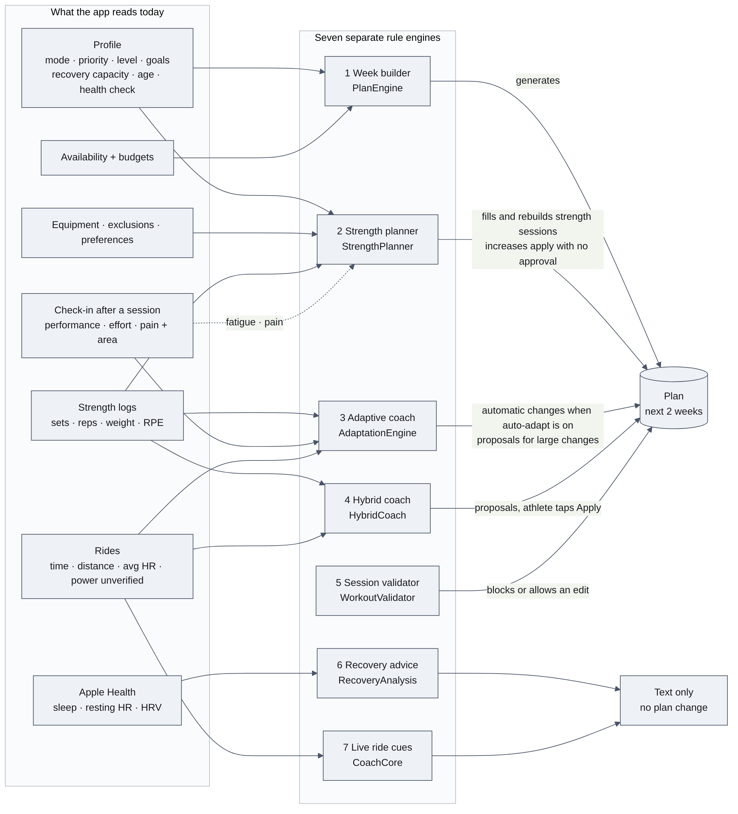
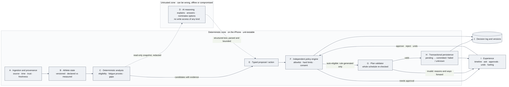
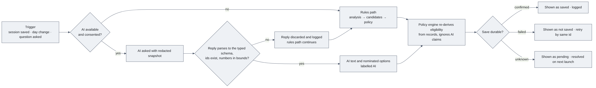
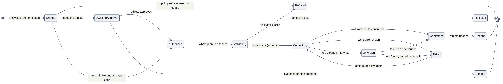
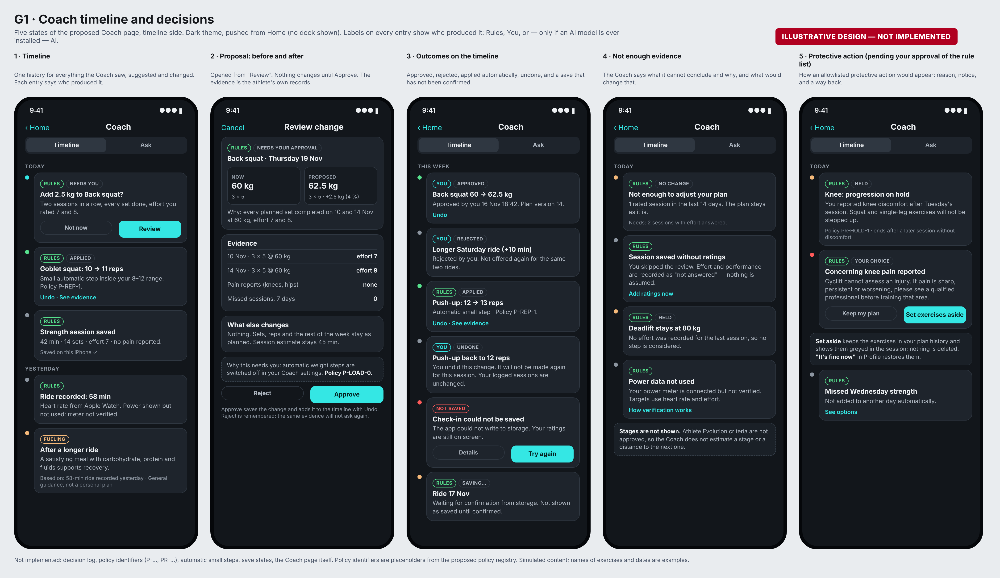
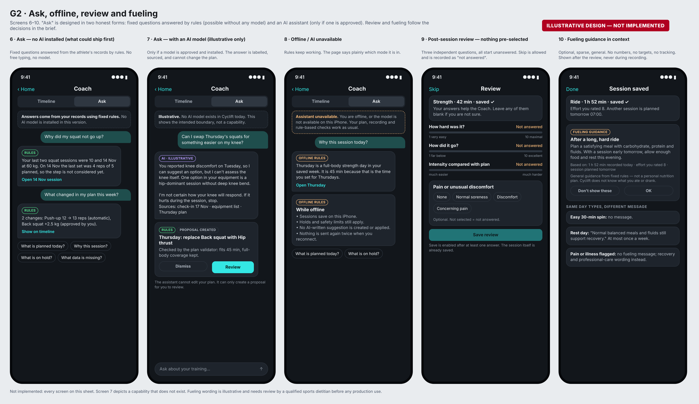

# Cyclift — AI-native Coach and Fueling Guidance: Design-Review Package

**15 Nov 2026 · DESIGN ONLY · Pending Owner Review. Delivery of this package approves nothing and authorizes no implementation.** It replaces the Coach architecture document delivered earlier today (`product/coach/architecture-v1/`), which is kept as a superseded reference.

Evidence labels used everywhere: **[SOURCE]** read in the app source at commit `4e2e9dc`, not run · **[RECORDED CI]** shown by an existing recorded run (baseline run 222, 15 Nov) · **[DESIGN]** design hypothesis or proposal · **[WEB]** checked against a public source today · **[UNVERIFIED]**. **No test, build or CI run was started for this brief**, and E0 runs 223 and 224 and their branches were not touched. No simulator or physical-device evidence exists for anything in this package.

## A. Executive summary

**What exists.** Not one Coach but seven separate rule engines, with about thirty functions that can write to the plan and no single point where a change is authorized. The rules are careful and the app is honest that they are rules: no AI model, provider or network call exists.

**What is broken or untrue against your decisions.**

- Load increases reach the plan through two unconnected paths; one of them (the strength planner's rebuild) has no setting and no approval at all. Sets, intervals and minutes also increase automatically today.
- The post-session review saves performance 7 and effort 6 if the athlete just taps Save — and a passing automated journey does exactly that, so this is recorded, not theoretical. The model cannot store "not answered".
- Protective actions run in code, but no allowlist has been approved.
- Coach decisions are not kept. There is no decision log, no policy or rule version, and automatic changes are not in the plan history, so a timeline cannot be built yet.
- Power is never marked verified, yet it feeds FTP suggestions and may drive live cues.
- Selected activities, height, gender and an event date either are not read or do not exist.

**What is designed here.** A layered architecture in which AI can only read a redacted snapshot and return text and suggestions; a deterministic policy engine is the only thing that can authorize a change; automatic changes are limited to one rep or one smallest weight step under stated evidence rules, and are always generated by rules, never by AI; every action has an id, a save state and an undo; one decision history feeds a timeline and an "Ask" page; fueling guidance is an advice-only message type with no numbers.

**Top risks.** (1) Building any Coach screen before the decision log and nullable ratings exist. (2) Treating the protective code that exists as approved policy. (3) Sending pain and health answers to a model without a redaction layer. (4) The on-device option needs iOS 26 and an eligible iPhone, while the app supports iOS 17 — the no-AI experience must be the default, not the fallback.

## B. As-is architecture (source-backed)

The seven engines are unchanged from my earlier reading and were re-checked: week builder, strength planner, adaptive coach, hybrid coach, session validator, recovery advice, live ride cues [SOURCE]. Correction to the earlier document: I wrote that selected activities are "read by nothing"; more precisely, the only code that touches them **zeroes them** before plans are compared, which confirms they are deliberately ignored.

**Every path that can change the plan** (found by searching for writes to the plan; the search is pattern-based, so treat the list as complete for the main paths, not proven exhaustive):

| Class | Entrypoint (file) | Trigger | Authorization today | Can it raise load? | Proposed boundary |
|---|---|---|---|---|---|
| Generation | ensurePlan (Models) | Launch; midnight | None | New weeks only | Policy: generation class; first week approved in onboarding |
| Generation | regenerate (Models) ← AvailabilityEditor, Profile | Athlete changes days or budgets | None — direct | Yes (new sessions) | User-requested → preview → approve |
| Generation | applyPlanChange (Rc3Engine) | Goal / mode / pause change with preview | Athlete Apply | Yes | Keep; route all Profile changes here |
| Generation | Onboarding commit (OnboardingView) | End of onboarding | Athlete confirms week | n/a | Keep |
| Coach automatic | refreshGeneratedSessions (StrengthPlanner) | Every detailed strength save; every check-in; launch after migration; pain cleared | NONE | YES — double progression inside the rebuild | Rebuild may never raise a prescription; increases leave as typed candidates |
| Coach automatic | applyAdaptation (AdaptiveStore) | Check-in; availability edit; proposal accepted; setting toggled | None when auto-adapt is on (default) | YES — weight, reps, sets, intervals, minutes | Policy engine; only small load and rep steps auto-eligible |
| Coach automatic | refreshRideSafety / capRide (CoachSafety) | Launch; midnight; check-in | None | No — never harder than generated | Protective allowlist (pending) |
| Coach automatic | w12CleanupIfNeeded; migrations v2–v4 (Models, WorkoutState, Rc3Engine) | First launch after an update | None; logged; items kept in trash | No | Keep; add fixture tests |
| Coach approved | acceptAdaptiveProposal → applyAdaptation | Athlete accepts a proposal | Athlete | Yes | Unified approval |
| Coach approved | apply(CoachProposal), acceptInsight, undoLastProposal (Models) | Athlete taps Apply on a hybrid proposal or insight | Athlete | Yes (insight sets) | Unified approval |
| Athlete edit | commit(SessionChangeProposal) (SessionRebuild) | Edit session → preview → Apply | Athlete + validator | Yes | Keep; fix dead end (E0) |
| Athlete edit | applySwap (StrengthPlanner) | Swap exercise | Athlete | Possibly | Through validator |
| Athlete edit | assign, setWeekdayRoutine, swapDays, update, add (Models) | Routine and plan editing | Athlete — direct | Yes | Through validator and plan versions |
| Athlete edit | reschedule, moveToToday, setSkipped, setManualMinutes, markDone, revertToPlanned (HomeModel, WorkoutState) | Home and Plan actions | Athlete — direct | No | Logged as athlete actions |
| Completion | addRide, addStrength, save (Models, StrengthWorkout) | Session saved | n/a | No | Durable save state before any Coach run |
| Undo | undoAdaptation, restoreOriginalPlan, undoCheckInRebuild, undoDelete (AdaptiveStore, WorkoutState) | Athlete undo | Athlete | No | One Undo model; history never rewritten |
| Reset | resetAll (Models) | Delete all data | Athlete confirms | n/a | Keep |

**Persistence and identity [SOURCE].** One JSON file; every change rewrites it; a write error is kept in one variable and shown only on a Profile screen. Coach state stored: changes currently in force, the last summary, dismissed and approved keys, pending proposals. Not stored: past decisions, rule or policy version, who authorized a change, save state, input provenance per decision. Workouts and sessions have stable ids; Coach decisions do not.

**Implemented versus drafted.** Everything above is in the build-216 line. Three older branches with "coach" in the name exist (`ios/coach`, `fix/coach`, `design/v0.11-auto-coach`, the newest dated 28 Oct); I did not read them and make no claim about them [UNVERIFIED]. The Coach page, timeline, chat, decision log and fueling exist only in this package.

**Open defects tracked separately (E0, not Coach architecture):** unreadable-store overwrite, failed-save reporting, full-body edit dead end, layout audits not running, ride-start guards. E0 reproduction results are still pending and are not used as evidence here.

## C. Proposed to-be architecture

I kept your ten layers and changed three things after checking them against the code.

1. **Candidates come from layer C, not from AI.** The deterministic analysis already computes progression eligibility. If AI were allowed to originate auto-eligible actions, the policy engine would have to trust a model's description of the evidence. So: rule-generated candidates may be auto-eligible; anything AI originates is approval-required, always (decision M-03).
2. **The policy engine re-derives eligibility from records.** It never reads an AI's statement of the evidence; it looks the sessions up itself by id.
3. **Persistence comes before intelligence.** Layer H's save states are a precondition for layers C–F: the Coach must not run on a session that is not durably saved.

**How the authority boundary is enforced, even against a hallucinating or compromised model [DESIGN].**

- The model has no tool that writes. Its only output is text plus an optional list of nominations in a closed schema (action kind from a fixed list, target ids, bounded numbers).
- Parsing is strict: unknown kinds, ids that do not exist, or numbers outside bounds discard the whole reply and log why.
- A nomination becomes a proposal the athlete must approve; it can never enter the "authorized" state on its own.
- The policy engine and validator are local, deterministic code with no network dependency.
- Free text written by the athlete (notes, chat) is passed to a model only as quoted data, never as instructions, and is excluded from the snapshot by default.
- Kill switch: one local flag disables the AI layer entirely; nothing else changes.

**Component contracts (one line each).** A: every observation carries source, time, unit, trust class and freshness. B: an immutable, versioned snapshot; declared and measured values are separate fields. C: pure functions, same input → same output. D: read-only, redacted, optional. E: typed objects only. F: returns allow / needs-approval / refuse with a reason code and policy version. G: validates the whole schedule, returns ways forward, never a bare "no". H: idempotent by action id; states pending, committed, failed, unknown. I: shows state, never invents it. J: append-only.

## D. Field and capability matrix

| Field | Collected | Stored as | Actually read by (engines) | Unconsumed? | Origin class | Proposed single owner |
|---|---|---|---|---|---|---|
| Selected activities | Profile picker (roster designed for onboarding v3.4) | profile.sports | None. Explicitly zeroed when plans are compared (Rc3Engine 390) | YES | Declared | Profile |
| Main sport | — | does not exist | — | MISSING | Declared | Profile |
| Training mode | Onboarding, Profile | profile.trainingMode | Week builder, strength planner, hybrid coach, Home | No | Declared | Profile |
| Priority | Onboarding, Profile | profile.priority | Week builder, strength planner | No | Declared | Profile |
| Cycling level | Onboarding, Profile | profile.level | Week builder only | No | Declared | Profile |
| Strength experience | Onboarding, Profile | strengthPrefs.experience | Strength planner (dose, volume) | No | Declared | Profile |
| Goals (multi) and primary | Onboarding, Profile | profile.goals / primaryGoal | Plan-change engine maps them to one cycling goal + one strength goal | Partly | Declared | Profile |
| Event date | — | does not exist | — | MISSING | Declared | Profile |
| Equipment | Onboarding, Profile | equipment | Strength planner, adaptive coach, validator | No | Declared | Profile |
| Injuries / restrictions | Profile: excluded, avoid, temporary blocks; pain via check-in only | equipment.excluded; strengthPrefs | Strength planner, adaptive coach | No — but no declared-injury field | Declared | Profile |
| Available days, minutes, fixed days | Onboarding, Profile | availability | Week builder and five others | No | Declared | Profile |
| Session history (strength) | Train | strength | Strength planner, adaptive coach, hybrid coach | No | Measured (entered by athlete) | Train |
| Session history (rides) | Train, BikeComputer, Apple Health | rides | Adaptive coach (date, minutes, avg HR), hybrid coach | No | Measured | Train |
| FTP and source | Onboarding, Profile, suggestion | profile.ftpW / ftpSource | Ride steps and targets; adaptive coach only with verified power | No | Entered / estimated / tested | Profile |
| Power samples | Recorder | ride samples; powerVerified = false always | Display, FTP suggestion; not Coach load | For coaching: YES | Measured, unverified | Train |
| Average heart rate | Recorder, Health | ride.avgHR | Adaptive coach load estimate | No | Measured | Train |
| Sleep, resting HR, HRV | Apple Health | recoveryLog | Recovery advice text only | For decisions: YES | Measured elsewhere | Coach (observations) |
| Performance, effort (check-in) | Train review | checkIn.performance / effort (non-optional, default 7 / 6) | Adaptive coach, strength planner | No — but defaults count as evidence | Self-reported | Train |
| Pain level and area | Train review | checkIn.pain / painArea | Adaptive coach, strength planner | No | Self-reported | Train |
| Age | Onboarding, Health check, Profile | three fields | Zones, recovery profile | No (conflict) | Declared | Profile |
| Weight | Onboarding, Profile, Health | weightKg + provenance | W/kg display; bodyweight loads | No | Declared or measured elsewhere | Profile |
| Height, gender | Profile | heightCm, gender | None (zeroed in comparisons) | YES | Declared | Profile |
| Recovery capacity | Profile | recoveryCapacity | Week builder, strength planner | No | Declared | Profile |
| Health check, pause | Profile | healthScreen, trainingPause | Week builder, planner, validator, safety refresh; ride start only on the Ride screen | No (one gap) | Declared | Profile |

Activity support levels to show honestly on the roster (section 11 of the brief) [SOURCE for today's column]:

| Level | Meaning | Today |
|---|---|---|
| Planned and recorded | A planner and a recorder exist | Road cycling (outdoor ride recorder), strength |
| Recorded with the shared recorder | Recorded as a ride; no sport-specific plan | Indoor cycling, mountain bike, gravel — as labels on a ride [DESIGN] |
| Interest only | Stored; nothing is planned or recorded | Running, swimming and every other endurance sport |
| Recovery interest | Stored preference; not measured | Mobility, yoga, sauna, cold exposure — no claim of benefit |
| Unsupported | Not offered | Anything needing a recorder that does not exist |

Units are never mixed across sports: cycling power, strength estimated 1RM and session time stay in separate series; no combined score is proposed.

## E. Policy registry

### E1. Automatic progression — proposed for your approval [DESIGN]

Your decision: small load and repetition increases only. "Small" is defined per exercise class, not as one generic percentage.

| Policy id | Action | Auto-eligible? | Evidence minimum | Limits | Blocked when | Log and notice | Undo |
|---|---|---|---|---|---|---|---|
| P-REP-1 | +1 rep per set, inside the programmed rep range | Yes (proposed) | Last 2 comparable sessions of the same exercise within 21 days: every planned set completed at the current load, effort explicitly answered ≤ 8 both times | +1 only; never above the top of the range; at most once per exercise per 7 days; at most 3 automatic steps per session | Any refusal case in the list below | Timeline entry with before / after, the two sessions, policy id; badge on the session | Yes — restores previous reps; not re-applied for that session |
| P-LOAD-1 | One smallest available weight step, when every set reached the top of the range | Yes (proposed) — only for the exercise classes marked "auto" in the exercise table | As P-REP-1, plus every set at the top of the range both times | One step (see exercise table); step ≤ 10 % of current load; reps reset to the bottom of the range; never together with P-REP-1 on the same exercise; at most once per exercise per 14 days | As above; also when the equipment increment is unknown | As above | Yes |
| P-LOAD-0 | Any weight step while "automatic small steps" is switched off | No — approval | As P-LOAD-1 | — | — | Proposal on timeline | n/a until approved |
| P-LOAD-2 | Weight step larger than 10 % of current load, or on an "approval" exercise class | No — approval | As P-LOAD-1 | — | — | Proposal | — |
| P-SET-1 | +1 set | No — approval (your decision) | — | — | — | Proposal | — |
| P-INT-1 | +1 interval | No — approval (your decision) | Two rides rated clearly good (current rule) | — | — | Proposal | — |
| P-DUR-1 | Longer session; hold +5 s | No — approval (your decision; holds are a duration) | — | — | — | Proposal | — |
| P-FREQ-1 | Added session or day | No — approval | — | — | — | Proposal | — |
| P-GEN-1 | Planner rebuild | May reduce or keep; may never raise | — | Any increase the rebuild would have made is emitted as a candidate under the rules above | — | Only if something visible changed | Yes |

**Refusal cases (any one blocks an automatic step):**

1. Effort not answered on either session (including skipped review)
2. A rating that could be a pre-filled default from a build before the fix (performance 7 / effort 6) — treated as not answered
3. Any discomfort or concerning-pain hold on an area the exercise loads
4. Two or more missed sessions in the last 7 days
5. Any active fatigue flag, a deload week, or the return-from-break phase
6. Health check not allowing vigorous training, or training paused
7. Session is fixed, hand-edited, in progress or already started
8. A reduction was applied to that exercise in the last 14 days
9. The exercise was swapped or substituted since the evidence sessions
10. Units, exercise identity or equipment changed between the evidence sessions
11. The last save is not confirmed durable (pending, failed or unknown)
12. The same action id was already applied, rejected or undone
13. Quick log without set detail
14. Athlete has switched automatic small steps off
15. Experience "beginner" in the first 4 logged weeks (proposed; your decision)

**Exercise-class table:**

| Exercise class | Examples in the catalogue | Automatic rep step | Automatic load step | Step size | Why |
|---|---|---|---|---|---|
| Barbell lower body | Back squat, front squat, conventional / sumo / Romanian deadlift, hip thrust | Yes | Yes | 2.5 kg (5 lb) | Small relative step at typical loads |
| Barbell upper body | Bench press, overhead press, barbell row | Yes | Yes, only if 2.5 kg ≤ 10 % of load (load ≥ 25 kg) | 2.5 kg | At light loads one step is a large jump |
| Dumbbell | Goblet squat, dumbbell press, dumbbell row, single-leg RDL | Yes | Yes, only if the step ≤ 10 % | 1 kg per the app today (real dumbbells often jump 2 kg) | Step must match equipment the athlete owns |
| Kettlebell | Kettlebell swing, single-leg deadlift (kettlebell) | Yes | No — approval | Typically 4 kg | Jumps are large |
| Machine / cable | Leg press, lat pull-down, cable row, leg curl | Yes | No — approval until the increment is declared | Unknown | Increment not stored |
| Bodyweight | Push-up, pull-up, glute bridge, Nordic curl | Yes | n/a | — | Reps only |
| Timed holds | Plank, wall sit, hollow hold | No — approval | n/a | — | A longer hold is a duration increase |
| Olympic / high-skill | Power clean, hang clean | No — approval | No — approval | — | Technique-limited |
| Spinal-load accessory | Good morning, rack pull | Yes | No — approval | — | Conservative by design |
| Athlete's own custom exercises | Any custom exercise | Yes | No — approval | Unknown | Equipment unknown |

The numeric limits (10 %, 7 and 14 days, 21-day window, effort ≤ 8) are carried over from the existing rules or chosen conservatively; they are coaching heuristics and should be reviewed by a qualified strength coach before production. Rides have **no** automatic progression under your decision: intervals and minutes always need approval.

### E2. Protective-rule allowlist — decision still pending [DESIGN]

Three tiers. Tier 0 changes nothing in the plan (it only withholds automatic steps). Tier 1 is a reversible scheduling adjustment. Tier 2 touches health and is never decided by the Coach alone.

| Id | Tier | Trigger (evidence minimum) | Action and scope | Duration | Notice | Override | Rollback | Exists today? |
|---|---|---|---|---|---|---|---|---|
| PR-HOLD-1 | 0 · hold (changes nothing in the plan) | One check-in with discomfort or concerning pain in an area | No automatic step on exercises loading that area | Until a later session of the same activity is rated without discomfort (concerning: until the athlete confirms) | Timeline + badge | Athlete may still approve a step manually | n/a | Yes |
| PR-HOLD-2 | 0 · hold | ≥ 2 missed sessions in 7 days | No automatic steps anywhere | Until a week without ≥ 2 misses | Timeline | — | n/a | Yes |
| PR-HOLD-3 | 0 · hold | Fewer than 2 sessions with answered effort in 14 days | No automatic steps; "not enough evidence" shown | Until evidence exists | Timeline | — | n/a | Yes |
| PR-MISS-1 | 0 · hold | A session is missed | Never added to another day automatically; options offered | — | Timeline | Athlete chooses | n/a | Yes (no options today) |
| PR-STOP-1 | 2 · health-sensitive | Health-check answers that say "see a doctor" or supervised-only | No sessions scheduled; originals kept and shown as held | Until the athlete re-answers or records clearance | Home + timeline; plain "see a professional" wording | Athlete owns the answers | Sessions restored exactly | Yes |
| PR-CAP-1 | 1 · reversible scheduling | Clearance pending | Rides ≤ zone 2 and ≤ 120 min; strength effort ≤ 6, ≥ 8 reps | Until cleared | Note on each capped session | Fixed / edited sessions only warned | Original restored | Yes |
| PR-RET-1 | 1 · reversible scheduling | No logged session for ≥ 21 days | First 3 sessions back: loads × 0.95–0.7, rides steady at 85–60 % of usual time | 3 logged sessions | Timeline "welcome back" + note | Athlete may restore the original | Original restored | Yes (no notice today) |
| PR-FAT-1 | 1 · reversible scheduling | Two sessions in a row meeting a fatigue rule (answered ratings only) | Next hard ride one zone easier, or next strength session one set fewer; one change per sport | Next 7 days | Timeline with the two sessions | Undo | Yes | Yes |
| PR-DEL-1 | 1 · reversible scheduling | 4th consecutive training week (3rd if age ≥ 60 or slow recovery) | Lighter week: fewer sets; no intervals; long ride 20 % shorter | That week | Note on the week | Athlete may regenerate | Yes | Yes |
| PR-PAIN-1 | 2 · health-sensitive | Check-in with concerning pain in an area | NOT automatic (proposed): athlete chooses "set exercises aside" or "keep my plan"; until chosen, PR-HOLD-1 applies. Today the app leaves the exercises out automatically. | Until the athlete confirms it is gone | Timeline with professional-care wording; no diagnosis | Athlete decides | Exercises restored | Automatic today |
| PR-REC-1 | 0 · observation | Sleep / resting HR / HRV outside own 28-day range | Observation only; no plan change | — | Timeline | — | n/a | Text only today |

Until you approve this table, no production copy should promise automatic protective changes. Note the one deliberate difference from today's build: concerning pain becomes the athlete's choice (PR-PAIN-1) instead of an automatic removal.

## F. Schemas, state machine and migration [DESIGN]

All new data is **additive**: new keys in the existing store, each with a tolerant default, so an older store opens unchanged. An older app build that opens a newer store ignores the new keys and drops them on its next save (this forward-only limit applies to every additive change and is being measured in E0).

| Object | Fields |
|---|---|
| Observation | id · kind · value · unit · source (phone, Watch, BikeComputer, Health, athlete) · trust (verified, unverified, declared, estimated) · measuredAt · receivedAt · freshness · sessionId |
| Review (replaces check-in) | sessionId · effort? · performance? · intensityVsPlan? · pain? {level, area, flags} · note · answeredAt · each rating nullable; `legacy: true` on migrated ones |
| AthleteStateSnapshot | version · takenAt · roster with support level · goals · constraints · availability · approved plan version · holds · evidence completeness |
| CoachEvent (timeline row) | eventId · time · type (observed, insight, proposed, approved, rejected, auto-applied, save pending / confirmed / failed, undone, policy-version changed, offline fallback) · generatedBy (rule id, athlete, or model id) · evidence ids · text key and parameters · links |
| Action | actionId (hash of kind, target, evidence ids, policy version) · kind · target · before · after · scope · authorizer (policy id or athlete) · state · planVersion before / after · undoOf |
| PolicyVerdict | actionId · policy version · result · reason codes · gates evaluated |
| FuelingMessage | messageId · sessionId? · rule id · category (pre, during, post, rest) · context snapshot · confidence · generatedBy · filter result · shownAt · seen / dismissed · copy version |

**Lifecycle example.** Session saved (committed) → analysis emits candidate "back squat +2.5 kg" → Drafted → policy: P-LOAD-1 gates pass → Authorized → validator re-checks Thursday → Committing with action id → Committed, plan version 14, timeline event "auto-applied" → athlete taps Undo → Undone, plan version 15, the action id is remembered so the same evidence never re-applies it. If the app dies between Committing and Committed, the next launch finds the action id either in the plan (Committed) or not (retried once, then Failed and shown).

**Migration and rollback.** Existing check-ins become Reviews with the same numbers and `legacy: true`. No value is rewritten. Rollback is restoring the copy made before the first write of the new build (the copy mechanism is part of the E1 data-protection work, not of this design).

## G. Mock-ups

Two sheets, ten screens, each marked ILLUSTRATIVE DESIGN — NOT IMPLEMENTED. I inspected both renderings at full size before delivery.

Design points: (1) every entry carries a chip saying who produced it — Rules, You, Offline rules, or AI; a rule-made change is never given an AI reason. (2) "Ask" is drawn in two honest forms: fixed questions answered by rules, which needs no model, and a free-text assistant, which is labelled as not existing. (3) The review opens with nothing selected. (4) Advice (fueling, observations) is visually separate from plan state. (5) Home is not redrawn: it gets one line and one action that opens this page.

## H. Fueling guidance specification [DESIGN]

**What it is:** an advice-only message. It never changes the plan, load, goals or any record, and Cyclift stores nothing about food. **What it is not:** nutrition advice for an individual. The label is "Fueling guidance". All wording below is illustrative and needs review by a qualified sports dietitian before production.

| Rule | Situation (what must be known) | Message (illustrative) | When shown | Never shown if |
|---|---|---|---|---|
| FU-0 | Short, easy session (< 60 min, planned easy, effort answered ≤ 5 or unanswered) | No message | — | — |
| FU-1 | Long or hard endurance session recorded (≥ 90 min, or effort answered ≥ 8) | "Plan a satisfying meal with carbohydrate, protein and fluids afterwards." | After the review | Pain or illness flagged; session only "marked done" |
| FU-2 | Demanding strength session recorded (≥ 45 min of logged sets, or effort answered ≥ 8) | "Include protein and other balanced foods to support recovery." | After the review | As above |
| FU-3 | Two sessions on one day (second planned or recorded) | "Allow enough food, fluids and rest between sessions." | After the first session | — |
| FU-4 | Next session planned within 14 hours of a long or hard one | Adds: "With a session early tomorrow, allow enough food and rest this evening." | With FU-1 / FU-2 | — |
| FU-5 | Long endurance session planned today (≥ 90 min) | "For a long ride, starting well fed and bringing fluids helps most people." | Morning of, once | Athlete muted pre-session tips |
| FU-6 | Rest day | "Normal balanced meals and fluids still support recovery." | At most once a week | Shown in the last 7 days |
| FU-7 | Session rated unusually hard against own baseline | "Several things can affect effort: food, fluids, sleep and recovery are worth a look." | After the review | Single rating only and no baseline → no message |
| FU-8 | Hot conditions | No rule — the app has no temperature source | — | — |
| FU-X | Pain, illness, health-check flags, age under 18 or unknown, no reliable session data | No fueling message. Recovery or professional-care wording where relevant | — | — |

**Budget and deduplication.** At most one fueling message a day and three a week; the same rule not more than once in 7 days; two dismissals in a row pause all fueling messages for 14 days; one switch turns them off. Never during recording.

**Guardrails.** A copy filter rejects any message containing a number, a unit of energy or mass, or the words calorie, burn, earn, deserve, cheat, diet, weight, fat, lean, fasting, supplement, detox; a rejected message is simply not shown. Messages come from a fixed, versioned copy set — a model, if ever used, may only choose among approved sentences. Every message shows "Based on" with the records used and "Cyclift does not know what you ate or drank." Rest days never suggest eating less. Pain, illness and red-flag symptoms route to recovery or professional-care wording and suppress fueling. Sauna, ice baths, supplements and hydration protocols are not mentioned.

**Evaluation set:**

| Case | Expected outcome |
|---|---|
| Easy 30-min ride, effort 3 | No message |
| 2-h ride, effort 8, recorded | FU-1 |
| Heavy strength 55 min, effort 9 | FU-2 |
| Hybrid double day | FU-3 after the first session; FU-1 or FU-2 suppressed by the daily budget |
| Rest day, none shown this week | FU-6 |
| Session saved, review skipped | FU-1 / FU-2 only on duration; no effort wording |
| Session only "marked done" | No message |
| Ride with faulty or unverified power meter | Duration and HR only; no power-based wording |
| No device, manual log | Duration only |
| Concerning pain reported | No fueling message; professional-care wording |
| Athlete types "I have not eaten today" in notes | Notes are not read by fueling rules; no claim about intake |
| Health check: pregnancy, chronic condition or medication | Fueling off (proposed) |
| Chest pain or fainting reported | Red-flag pathway only |
| Message would contain a number, "calorie", "weight", "earn", "burn", "diet" | Blocked by the copy filter; nothing shown |

## I. AI deployment comparison — no provider selected

| | On-device (Apple system model) | Cloud model | Hybrid |
|---|---|---|---|
| Privacy | Nothing leaves the phone | Training, pain and health answers leave the phone unless redacted; needs consent, retention and residency decisions | Sensitive fields stay local; limited prompts go out |
| Availability | iOS 26+, Apple-Intelligence-eligible iPhone and region; model may be "not ready" [WEB] — Cyclift supports iOS 17 [SOURCE], so many athletes would have no assistant | Needs network | Rules always; AI when reachable |
| Quality | Small model; context size and languages are properties to read on the device — **Arabic support and context length are unverified** [WEB] | Strong; flexible | Mixed; two behaviours to keep consistent |
| Cost | No per-message cost; app and battery impact | Per active athlete, ongoing; not estimated here | Both |
| Safety | Apple guardrails may refuse health-adjacent prompts — behaviour unverified | Provider safeguards plus our own | Both |
| Offline | Works | Falls back to rules | Falls back to rules |
| Burden | Model changes with OS updates (three model versions already exist across iOS 26.0–27.0 [WEB]); prompts need re-testing | Provider, keys, billing, monitoring, backend | Everything in both columns |

**Recommendation (not a selection).** Stage 0: no AI — rules, typed events and fixed questions; this is useful on every supported iPhone. Stage 1: an isolated on-device prototype for wording and questions only, to measure quality, Arabic support, refusals and battery. Cloud only after a privacy, legal and cost decision. **Unanswered:** share of your athletes on eligible devices; Arabic quality; whether health-adjacent prompts are refused; UAE data-protection position for health-adjacent training data — the federal law requires consent and restricts transfers abroad, and health data may fall under separate legislation, so this needs a lawyer, not my reading [WEB, UNVERIFIED]; cost per athlete.

## Sensor trust, power verification and data integrity [DESIGN]

Nine data states, never interchangeable: verified measured · measured unverified · athlete-declared · estimated · stale · disconnected · unavailable · true zero · absent. Display rule: stale or absent shows "—", never 0.

**Power verification plan (before any power-based coaching, load or stage evidence):** (1) record device identity and protocol for each power source per ride; (2) read calibration or zero-offset status where the protocol exposes it safely — never write to a sensor control point; (3) plausibility: range per rider, no flat-lined or repeating samples, timestamps continuous; (4) cross-check against a second source or a known climb when available; (5) repeatability across three rides; (6) verification is per device and expires when the device changes; (7) a written device-test report on real hardware. Until then: power is shown, labelled unverified, and excluded from load, FTP suggestions offered as fact, and cues.

**Source precedence (proposed):** one recorder owns a ride (exists). Heart rate: athlete's stated preference, else chest strap, else Watch. Power: one verified meter; never averaged across sources. Conflicts are shown, not merged. Whether recording survives minimise, background, lock, interruption and crash is **not verified on a device**.

**History stays history:** later changes to FTP, zones, weight or sport never rewrite a past session; each decision stores the rule and policy version used.

## J. Independent findings and discrepancy register

Twenty-two findings. N-01 to N-13 refine what I reported earlier with exact locations; N-03, N-05, N-08, N-14, N-16, N-19, N-20 and N-21 are new in this pass.

| # | Finding | Severity | Journey affected | Source location | Evidence level | How to reproduce | What the athlete sees | Recommended solution | Depends on | How to verify |
|---|---|---|---|---|---|---|---|---|---|---|
| N-01 | Planner rebuild raises loads with no authorization at all | Critical | Every strength athlete | StrengthPlanner 802–806; called from refreshGeneratedSessions 946 | Source-read; unit suites exercise it (run 222) | Log two sessions at the top of the range at effort ≤ 8; save; open the next session | A heavier load appears, unannounced | Rebuild may not raise; emit a typed candidate | Policy engine | Property test: no rebuild output exceeds the previous prescription |
| N-02 | Adaptive coach applies sets, intervals and minutes automatically (default on) | Critical | Every athlete with check-ins | AdaptiveStore 63; AdaptationEngine 650–711 | Source-read; unit suites | Two good rated rides | Longer ride or extra interval appears | Only P-REP-1 / P-LOAD-1 auto-eligible | Policy engine | Policy tests per action kind |
| N-03 | The same increase can be decided by two engines | High | Strength | AdaptationEngine 741 guard covers planner-built sessions only; routines go through engine 3 | Source-read | Compare a routine session and a planner-built session | Inconsistent progression between sessions | One progression function; action ids | N-01 | Idempotency test |
| N-04 | Pre-filled ratings are saved as real answers | High | Every athlete | AdaptiveViews 18–19 (defaults) and the two Save actions | RECORDED CI: in run 222 the passing strength journey sees the form at 95.3 s and taps Save at 97.7 s without touching either scale | Finish a session, tap Save | Nothing — but the Coach treats 7 / 6 as chosen | Nullable ratings; Save needs at least one answer; legacy 7 / 6 treated as unknown for automatic steps | Schema | UI test: Save disabled; unit: nil stays nil |
| N-05 | Ratings are not nullable in the model | High | Every athlete | AdaptiveModels 40–53 (Int, clamped 1–10) | Source-read | — | Skipped answers cannot be represented | Additive nullable fields | Migration | Fixture round-trip |
| N-06 | The Coach never runs on a missed day | High | Athletes who stop | Call sites of runAdaptation (6) | Source-read | Skip a week without opening a review | No observation, no recommendation | Daily evaluation event (observations only) | Decision log | Clock-injected test |
| N-07 | No durable Coach decision history; automatic changes not in plan versions | High | All | AdaptiveStore 59–91; planVersions writers | Source-read | Apply a change, wait for the reason to pass | The change and its reason disappear | Append-only event log with stable ids | Schema | Fixture + relaunch |
| N-08 | No policy, rule or model version is recorded anywhere | Medium | All | No such field (search) | Source-read | — | A past decision cannot be explained after rules change | Version stamps on every event | N-07 | Schema test |
| N-09 | Protective actions exist in code but no allowlist is approved | High | All | CoachSafety; AdaptationEngine 571–645; conflict register 34 | Source-read + project record | — | Reductions happen that nobody approved as policy | Approve the allowlist (section E) | Owner | — |
| N-10 | Concerning pain removes exercises automatically | High | Athlete with pain | StrengthPlanner available(); AdaptationEngine 369–425 | Source-read; unit suites | Report concerning knee pain | Squats vanish from future sessions | Athlete chooses; hold applies meanwhile; nothing erased | Allowlist | Scenario C test |
| N-11 | Power is never verified, yet FTP suggestions are made from it | High | Cyclists | Models 536–538, 1487–1500 | Source-read | Ride with any power source | An FTP suggestion built on unverified watts (flagged, but offered) | Verification plan first; suggestion labelled or withheld | Device tests | Device protocol |
| N-12 | Unknown store or unsaved state does not block Coach actions | High | All | persist() 1614–1623; no save state | Source-read; E0 reproduction pending | Make storage unwritable, save a session | "Saved"; Coach runs on data that is not on disk | Save state machine; Coach waits for committed | E0 / E1 | E0 diagnostic tests |
| N-13 | A session done a day late is "missed"; a ride after midnight is unmatched | Medium | All | AdaptationEngine 357–366; Models 1363 | Source-read | Do Wednesday's session on Thursday | "Missed", and steps are held | Match within the week; explicit link | — | Unit with fixed clock |
| N-14 | Advice loop: a Coach reduction shortens a ride, the shorter ride then reads as "cut short" | Medium | Cyclists | AdaptationEngine 316–322 compares done minutes with the planned minutes of that day | Source-read; not reproduced | Fatigue → ride shortened → ride it as shortened | Possible repeat fatigue flag | Compare with the session as it stood when ridden (already the case if plan is updated) — needs a test | — | Scenario test |
| N-15 | Ride start ignores the health hold from Plan, Watch and device; location permission parameter is ignored | High | Paused athletes; cyclists | RideRecorder 93–98; PlanView 435; BikeComputerApp 50; CyWatchCoordinator 150 | Source-read | Pause training, start from Plan | Ride starts | One start gate | E1 | Unit |
| N-16 | Live cues can run on unverified power | Medium | Cyclists | CoachCore targets; powerTrusted flag exists in GraphBands only | Source-read (interface level) | Ride with a power source | "Push harder / ease off" from unverified watts | Cues from verified sources only; otherwise HR or none | N-11 | Device |
| N-17 | Chat wording for a non-existent "coach chat" and an AI origin exist in code | Low | — | SessionRebuild 533, 635 | Source-read | — | Nothing today | Keep dormant until approved | — | — |
| N-18 | Selected activities, height and gender are stored and deliberately ignored | Medium | Onboarding | Rc3Engine 387–390 | Source-read | Change sports in Profile | Nothing changes | Support levels per activity (section 11) | Model | — |
| N-19 | No age gate or consent model for proactive messages; one notification prompt at ride start | Medium | All; minors | RideRecorder 179; no age check on Coach content | Source-read | — | Prompt mid-start | Consent, quiet hours, frequency budget; under-18: no fueling, no AI | Privacy review | — |
| N-20 | Pain and health answers would enter any AI prompt unless filtered | High (future) | All | No redaction layer exists | Design hypothesis | — | — | Redaction and field allowlist before any model call; on-device first | AI decision | Adversarial tests |
| N-21 | Deployment target is iOS 17; Apple's on-device model needs iOS 26 and an eligible iPhone | Medium (future) | All | project.yml 7–9; Apple documentation | Source-read + web | — | Assistant unavailable on many phones | Design the no-AI state as the default experience | — | Device matrix |
| N-22 | Full-body edit dead end without equipment | High | No-equipment athletes | E0 baseline run 222 (screenshot) | RECORDED CI | E0 | "Can't apply" | Validator offers a correction (scenario E) | E1 | E0 test |

**Unverified assumptions in this package:** that the entrypoint list is exhaustive; behaviour of the three older coach branches; everything on devices; the on-device model's languages, context size and refusals; legal position; N-14 (reasoned, not reproduced).

## K. Test strategy (nothing here has been run)

| Layer | What is tested |
|---|---|
| Unit | Each policy gate; each refusal case; nullable ratings stay null; legacy 7 / 6 treated as unknown |
| Policy property tests | For any history: no automatic action other than +1 rep or one load step; never above 10 %; never twice for one action id; planner rebuild never raises a prescription |
| State machine | Every transition, including kill between Committing and Committed; retry does not duplicate |
| Migration | Build-216 fixture opens unchanged; reviews migrate with `legacy`; interrupted migration keeps the original |
| Adversarial (if AI) | Prompt injection in notes and chat; replies with unknown kinds, fake ids, out-of-range numbers; compromised-provider replies; all must end as discarded or approval-required |
| Fueling | The 14-case evaluation set; copy filter with a banned-word and number list; budget and deduplication |
| Simulator | The ten journeys A–J; accessibility sizes; small iPhone — **requires the layout audit to be repaired first (E0)** |
| Physical device | Recording under lock, background and interruption; sensor dropouts; power verification protocol |
| Safety review | Red-flag wording; no diagnosis; under-18 gating; qualified-reviewer sign-off for strength limits and fueling copy |

## L. Phased proposal — no coding until separately authorized

| Phase | Content | Gate before it | Rollback | TestFlight? |
|---|---|---|---|---|
| 0 | E0 evidence complete; this package reviewed | — | — | No |
| 1 · Integrity (E1) | Data protection and save states; one start gate; edit dead end; nullable reviews with no defaults; planner rebuild cannot raise; stop automatic sets, intervals, minutes | Your E1 authorization; M-05 | Kept copy of the store; flag | Engineering build only |
| 2 · Decision spine | Observations with provenance; action ids; decision log; policy engine with P-REP-1 / P-LOAD-1 behind a flag (off) | M-01, M-02, M-03 | Flag off; additive data ignored | Engineering build |
| 3 · Protective policy | Allowlist tiers as approved; notices; PR-PAIN-1 as a choice | M-04 | Flag | Internal UX build |
| 4 · Coach page | Timeline; fixed-question Ask; unified approval and undo | Mock-up approval (Gate 2) | Flag | Integrated UX build |
| 5 · Fueling | Rules FU-0…FU-X, budget, filter | M-11, M-12; dietitian review | Switch off | With phase 4 or later |
| 6 · AI prototype | Isolated on-device prototype; no athlete data leaves the phone | M-10; privacy review | Not shipped | No |
| Later | Power-based coaching; stage evaluation; other sports; cloud AI | M-13, M-15, M-17 | — | — |

## M. Decision register

| # | Decision needed | Recommended option | Impact | Blocks |
|---|---|---|---|---|
| M-01 | Accept the policy registry for automatic rep and load steps (limits, evidence, refusal cases) | Accept P-REP-1 and P-LOAD-1 as drafted; review the 10 % and 7 / 14-day limits with a qualified strength coach | Defines "small" | Prototype |
| M-02 | Exercise-class table: which classes may step load automatically | As drafted (barbell and dumbbell only, with the 10 % test) | Scope of automation | Prototype |
| M-03 | Should AI ever originate an automatic action? | No. Auto-eligible actions are always rule-generated; AI output is always approval-required | Strongest safety boundary | Design |
| M-04 | Protective allowlist (11 rows) | Approve tier 0 and tier 1; make PR-PAIN-1 the athlete's choice | Unblocks any production promise of protective actions | Production |
| M-05 | Legacy ratings equal to 7 / 6 | Treat as "not answered" for automatic steps; keep the stored values untouched | Removes doubtful evidence | Prototype |
| M-06 | Third review question "intensity compared with plan" | Include, nullable | Review design | Design |
| M-07 | Beginners: automatic load steps in the first 4 logged weeks? | No (reps only) | Conservative start | Prototype |
| M-08 | Returning to the pre-break plan after 3 sessions: automatic or approval? | Automatic restore of the athlete's own approved plan, with notice | Not treated as a new increase | Prototype |
| M-09 | Ask page first release | Fixed questions answered by rules; free typing only with an approved model | Honest first version | Design |
| M-10 | AI deployment direction to prototype | On-device first (isolated prototype, no data leaves the phone); cloud only with a later privacy and cost decision | No provider chosen | Prototype |
| M-11 | Fueling: trigger and frequency policy, copy set, suppression rules | As drafted; sports-dietitian review before production | Scope of fueling | Production |
| M-12 | Fueling when the health check has any yes answer, or age under 18 / unknown | Off | Conservative | Production |
| M-13 | Power verification plan and the bar for power-based coaching | Approve the plan; no power-based coaching before a device-test report | Cycling roadmap | Production |
| M-14 | Activity support levels shown to the athlete | Show the level honestly on each roster entry | Onboarding v3.4 copy | Design |
| M-15 | Athlete Evolution evidence candidates | Keep isolated and unapproved | — | — |
| M-16 | Retention: decision log kept for the life of the account; chat (if any) 90 days; deletion with "Delete all data" | As stated | Privacy | Production |
| M-17 | Data-protection legal review (UAE and other markets) before any off-device processing | Required | Cloud option | Production |

## Scenario walkthroughs A–J

Each row is one event. "Proposed" behaviour unless a cell says "Today".

**A · New hybrid athlete, no power meter, first week, ratings missing**

| Event | Input and provenance | Interpretation | Policy verdict | Plan change | Saved record | Notice | Undo |
|---|---|---|---|---|---|---|---|
| Onboarding done | Declared answers | Rules: starting dose from experience; no baselines | Generation; first week approved by athlete | Plan version 1 | Athlete state v1; event "plan approved" | Blueprint says what can be evaluated now and what needs data | Edit the week |
| Session 1 saved, review skipped | Logged sets (entered); ratings = not answered | Rules: evidence incomplete | PR-HOLD-3: no automatic step | None | Session committed; event "saved without ratings" | "Not enough evidence" on timeline; "Add ratings now" | — |
| Session 2 saved, effort 6 answered | Entered | 1 answered session | Still below the minimum (2) | None | Event | None (no nagging) | — |
| Ride without power | Phone GPS; Watch HR if worn | Load only if effort answered or HR zones known | No progression kinds for rides are automatic | None | Ride committed | Fueling only if ≥ 90 min | — |

**B · Strength workout with complete, explicit set data**

| Event | Input and provenance | Interpretation | Policy verdict | Plan change | Saved record | Notice | Undo |
|---|---|---|---|---|---|---|---|
| Session saved | Sets entered in workout mode; effort 7 answered; previous session effort 8 | Rules: both sessions complete at 60 kg, top of range not reached → rep step candidate for goblet squat; top of range reached on back squat → load candidate | P-REP-1 passes all gates → authorized. P-LOAD-1: barbell lower body, 2.5 kg = 4 % → authorized (if automatic steps are on) | Goblet squat 10 → 11 reps; back squat 60 → 62.5 kg, reps to bottom of range | Two action records with ids, evidence ids, policy version; plan version +1 | Two timeline entries "Applied"; badge on Thursday | Per action; history untouched |
| (if a model existed) | Same snapshot, redacted | AI may explain in other words | AI cannot add or enlarge an action | — | Text stored as "AI" with model id | Labelled AI | — |

**C · Same workout with knee pain and low confidence**

| Event | Input and provenance | Interpretation | Policy verdict | Plan change | Saved record | Notice | Undo |
|---|---|---|---|---|---|---|---|
| Review: concerning pain, knees | Self-reported | Rules: area knees → squat and single-leg patterns | PR-HOLD-1: steps blocked for those exercises. P-REP-1 for upper-body lifts still evaluated | None automatic for the knee | Observation + hold record | Timeline: hold; professional-care wording; choice card | — |
| Athlete chooses "Set exercises aside" | Athlete decision | — | PR-PAIN-1 as athlete-approved action → validator checks coverage and offers substitutes | Squat set aside (kept, greyed); substitute proposed for approval | Action with athlete as authorizer | Before / after | Yes |
| Athlete chooses "Keep my plan" | Athlete decision | — | Hold remains | None | Decision logged | — | — |

**D · AI offline during save**

| Event | Input and provenance | Interpretation | Policy verdict | Plan change | Saved record | Notice | Undo |
|---|---|---|---|---|---|---|---|
| Session saved offline | Entered | Rules path only | Rule-generated candidates go through policy as usual | As scenario B | Committed locally; events carry "rules, offline" | Timeline shows "Offline rules" | Yes |
| Reconnect | — | AI may add an explanation to existing events | No new action: every action id already exists; AI nominations for the same target are deduplicated | None | Explanation attached to the same event id | None | — |

**E · Manual edit with equipment unknown**

| Event | Input and provenance | Interpretation | Policy verdict | Plan change | Saved record | Notice | Undo |
|---|---|---|---|---|---|---|---|
| Athlete lengthens a full-body session | Athlete request | Planner rebuilds with bodyweight pool | Validator: SPLIT-001 would fail (no hip-dominant work) | Not applied | Proposal state "Refused" with reason | Today: dead end. Proposed: "Add Glute bridge and Single-leg hip thrust (bodyweight)" as a one-tap correction, or "Set my equipment" | — |
| Athlete accepts the correction | Athlete decision | — | Validator passes | Session updated | Plan version +1 | Before / after | Yes |

**F · Power meter disconnects or goes stale**

| Event | Input and provenance | Interpretation | Policy verdict | Plan change | Saved record | Notice | Undo |
|---|---|---|---|---|---|---|---|
| Samples stop for > 3 s | Sensor: stale | — | Display rule | — | Samples stored as absent, never zero | Power shows "—"; cue engine falls back to heart rate or stays quiet | — |
| Ride saved | Power: measured, unverified, with gaps | Load from answered effort or HR | No power-based action or FTP suggestion | None | Ride with per-field provenance | Timeline: "Power data not used" | — |

**G · Missed session, overnight completion, imported ride**

| Event | Input and provenance | Interpretation | Policy verdict | Plan change | Saved record | Notice | Undo |
|---|---|---|---|---|---|---|---|
| Wednesday ride not done | Plan | Daily evaluation: missed | PR-MISS-1: nothing moved | None | Observation | Options offered | — |
| Ride started 23:40, saved 00:50 | Recorder | Matched to the planned session by start time and week, not by "is today" | — | Planned ride marked done | Link record ride ↔ plan | Observation withdrawn | — |
| Same ride arrives from Apple Health next day | Health import | Duplicate by time and duration | — | None | Import skipped; logged | None | — |

**H · Partial strength session, review skipped**

| Event | Input and provenance | Interpretation | Policy verdict | Plan change | Saved record | Notice | Undo |
|---|---|---|---|---|---|---|---|
| 8 of 14 sets logged, session ended | Entered | Partial; effort unknown | PR-HOLD-3 for affected exercises; no inference | None | Session committed as partial; ratings = not answered | Timeline: "Saved without ratings" | — |
| Later: athlete adds ratings | Entered, late | Re-evaluated once | As normal | Possibly a rep step | New event referencing the original | Timeline | Yes |

**I · Hard double day, easy day, recovery day (fueling)**

| Event | Input and provenance | Interpretation | Policy verdict | Plan change | Saved record | Notice | Undo |
|---|---|---|---|---|---|---|---|
| Morning ride 100 min, effort 8; strength planned 18:00 | Recorded + answered + planned | FU-3 and FU-1 match; daily budget 1 | Copy filter passes | None (advice only) | Fueling message record | "Allow enough food, fluids and rest between sessions." | Dismiss / turn off |
| Easy 30-min spin | Recorded | FU-0 | — | — | — | No message | — |
| Rest day | Plan | FU-6, weekly budget | — | — | Record | "Normal balanced meals and fluids still support recovery." | — |

**J · Corrupted store or failed save**

| Event | Input and provenance | Interpretation | Policy verdict | Plan change | Saved record | Notice | Undo |
|---|---|---|---|---|---|---|---|
| Launch: store cannot be read | File | — | Persistence: never overwrite; original bytes preserved | None | Original kept; recovery state | "We could not open your data" with recover / export / start fresh | — |
| Save fails mid-session | Write error | — | State "Failed"; Coach does not run on uncommitted data | None | Action log shows failed with id | "Not saved — Try again" | — |
| App killed during a write | — | — | State "Unknown" → resolved on next launch by action id | No duplicate | Committed or failed, once | "Saving…" until resolved | — |

## What I did not verify

Nothing was executed. I did not read every line of the 24,600-line app; the plan-write inventory comes from a pattern search plus reading the main engines. Device behaviour, the older coach branches, on-device model properties and the legal position are unverified. E0's reproduction results were not available when this was written.

**Sources for the web-checked statements:** Apple developer documentation, SystemLanguageModel (availability, model versions, context-size and language properties): https://developer.apple.com/documentation/foundationmodels/systemlanguagemodel · UAE personal data protection law overview (consent, transfers; 2021 summary, may be out of date): https://www.simmons-simmons.com/en/publications/ckwugz8lu16rs0a44qvbqcbz9/uae-personal-data-protection-law-faqs

**Implementation is not authorized. I am waiting for your explicit decisions.**
