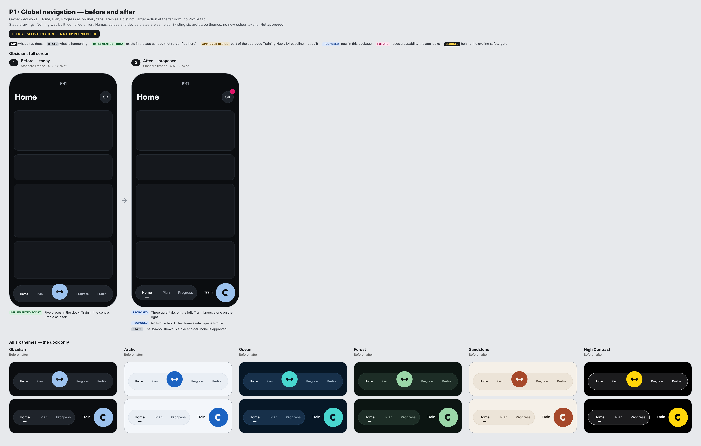
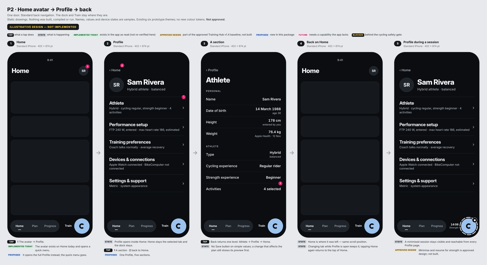
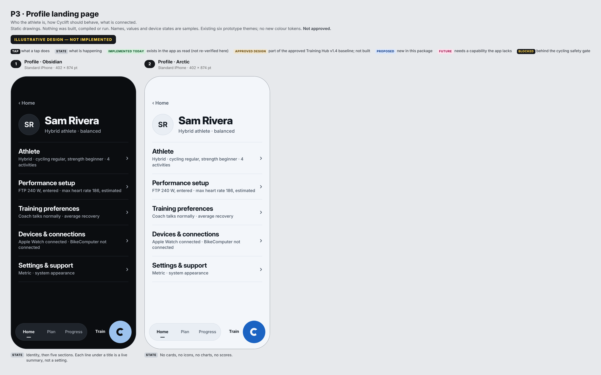
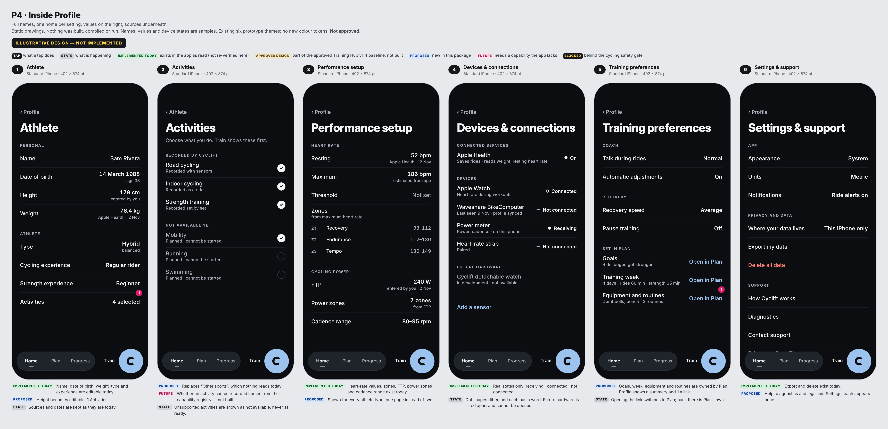
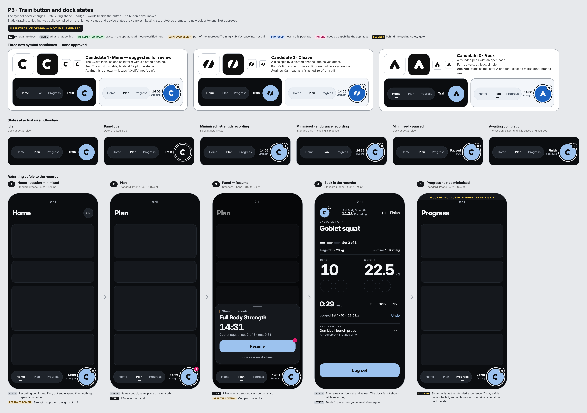
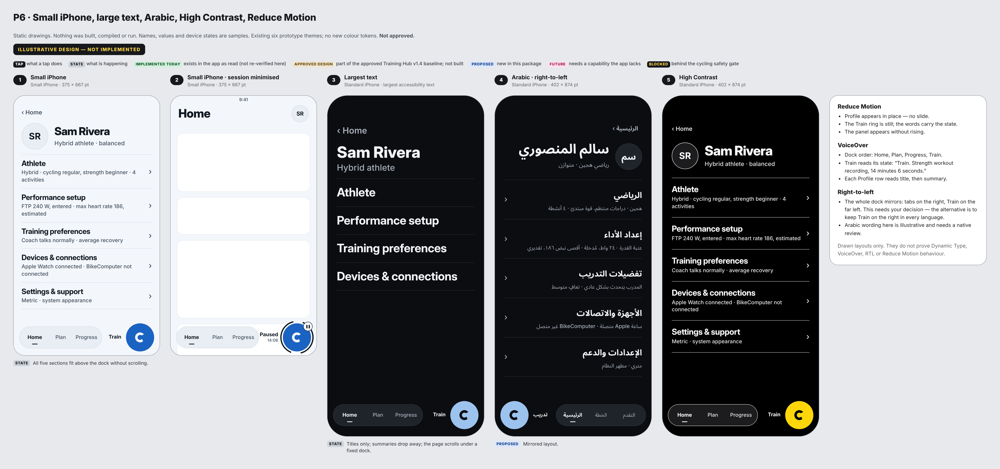
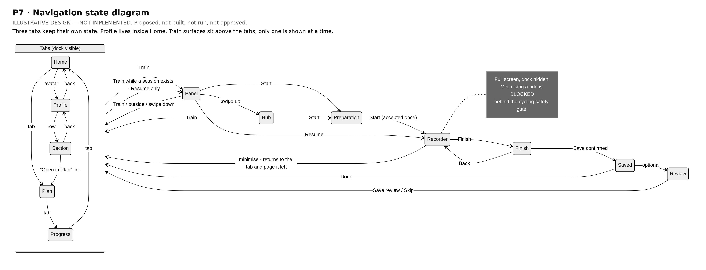

# Profile and global navigation — design v1.0 (owner decision D)

Status: **Current Draft — pending owner review. Nothing here is approved or final.** · Version 0.1 · 14 Nov 2026 · Level 3
**ILLUSTRATIVE DESIGN — NOT IMPLEMENTED.** Static drawings only. No code, navigation, onboarding, data model, branch,
Home, Plan, Progress, Train, firmware or build was changed.
Training Hub v1.4 remains the approved design baseline; its pending matters and the two open test defects remain pending.
Builds on `PROFILE_PHASE0_AUDIT_AND_IA.md` (read-only audit of commit `4e2e9dc`).

## 1. Sheets

| | |
|---|---|
| P1 Global navigation, before and after, six themes |  |
| P2 Home avatar → Profile → back |  |
| P3 Profile landing, Obsidian and Arctic |  |
| P4 Athlete · Activities · Performance setup · Devices & connections · Training preferences · Settings & support |  |
| P5 Train button and dock states |  |
| P6 Small iPhone · large text · Arabic · High Contrast · Reduce Motion |  |
| P7 Navigation state diagram |  |

## 2. What is proposed

**Dock.** Three quiet text tabs — Home, Plan, Progress — in one pill on the left. Train is a separate, larger round
control (72 pt against 44 pt tab targets) at the far right. Between them is a fixed label slot that reads "Train" when idle
and the session's time or state when one exists. Nothing in the dock moves or changes size between states.

**Train symbol.** Three new candidates: Mono, Cleave, Apex. Mono is suggested for review because it is one solid shape that
holds at 22 pt and is the most ownable; its weakness is that it is a letter. None is approved; Mono appears in the drawings
only as a placeholder.

**Train states.** Ring shape, a badge and words — never colour alone, never animation: idle · panel open (outlined) ·
strength recording (segmented ring, dot, time) · endurance recording (whole ring, dot, time) · paused (split ring, pause bars,
"Paused") · awaiting completion (three-quarter ring, "!", "Finish · not saved").

**Profile.** One Profile, opened from the Home avatar, shown inside Home with the dock still present. Five sections:

| Section | Holds | Does not hold |
|---|---|---|
| Athlete | Name, date of birth, height, weight; athlete type; experience; activities | Charts, history |
| Performance setup | Heart-rate values and zones; FTP, power zones, cadence range | Progress metrics |
| Training preferences | Coach talk and automatic adjustments; recovery speed; pause training; **links** to goals, week, equipment and routines in Plan | The editors for those — Plan owns them |
| Devices & connections | Apple Health; Apple Watch; Waveshare BikeComputer; sensors; future hardware listed apart and not openable | Anything shown as available that is not |
| Settings & support | Appearance, units, notifications; where data lives, export, delete; help, diagnostics, contact, legal | A second copy of any setting |

## 3. Route map — every current route and where it goes

| Today | From | Proposed destination |
|---|---|---|
| Profile tab | Dock | **Removed.** Home avatar → Profile |
| Quick menu (overlay) | Home avatar | **Removed.** The avatar opens Profile directly |
| "View profile" | Quick menu | Profile landing |
| My profile (fact list) | Quick menu | Athlete |
| Goals & training preferences (fact list) | Quick menu | Training preferences (summary + links to Plan) |
| Devices & connections | Quick menu | Devices & connections |
| App settings | Quick menu | Settings & support |
| Help & support | Quick menu | Settings & support › Support |
| Header → Personal | Profile tab | Athlete › Personal |
| Type & experience | Profile tab | Athlete |
| Goals | Profile tab | Plan (link from Training preferences) |
| Your week | Profile tab | Plan (link) |
| Equipment | Profile tab | Plan (link) |
| FTP → "Power & cycling" | Profile tab | Performance setup; bike name and wheel size → Devices & connections › BikeComputer |
| Heart rate | Profile tab | Performance setup; preferred source → Devices & connections |
| Preferences › Recovery | Profile tab | Training preferences |
| Preferences › Coach adjustments | Profile tab | Training preferences (on / off); the list stays with Coach on Home |
| Preferences › Strength split, programming | Profile tab | Plan (link) |
| Preferences › Routines, routine per weekday, my exercises | Profile tab | Plan and Train only |
| Preferences › Other sports | Profile tab | Athlete › Activities |
| Devices & sensors | Profile tab | Devices & connections |
| Apple Health | Profile tab | Devices & connections › Apple Health |
| Health & safety | Profile tab | Training preferences › Pause training (saved health answers stay reachable there) |
| Settings (units, appearance, notifications, ride & coach, data, about) | Profile tab | Settings & support; "Ride & coach" splits: coach → Training preferences, ride screen options stay with the ride screen |
| Home setup checklist → "Connections" | Home | Devices & connections |

## 4. Duplicated editors and settings (from the audit) and their single owner

| Duplicate today | Single owner proposed |
|---|---|
| Two profile structures (tab and quick menu) | One Profile |
| Lifting experience (Type & experience; Strength programming) | Athlete |
| Equipment preset and supersets (Your week; Equipment) | Plan |
| Heart-rate source (Profile; BikeComputer settings) | Devices & connections — the device follows the phone (needs a decision) |
| Units (Settings; BikeComputer settings) | Settings & support — same condition |
| Ride tiles (Settings; ride screen) | The ride screen |
| Coach adjustments (Profile; Home) | Coach on Home; Profile keeps only on / off |
| Routines, exercises (Profile; Plan; strength screens) | Plan and Train |
| Privacy, terms, diagnostics, version (several places) | Settings & support |

## 5. Shared onboarding dependency

Personal, Type & experience, Goals and Your week in Profile are the **onboarding editors themselves**, and the device list is
the one onboarding uses. They are not moved or modified here.
Proposal: **Profile-only presentation.** Profile's rows are new, read the stored values, and open the existing editor
unchanged when a value is tapped. Consequence, stated plainly: the editors behind the rows will still look like onboarding
until changing them is separately authorised.

## 6. Presenter and ownership conflicts

| Fact today | Conflict or risk |
|---|---|
| The app has five pages held by number: Home 0, Plan 1, Ride 2, Progress 3, Profile 4. Code jumps by number (for example the Home checklist opens page 4) | Removing the Profile page changes or orphans those jumps; each must be re-pointed |
| **Ride is itself a hidden page (2)** reached from the centre button; the dock is removed while a ride records | A right-side Train button plus full-screen recording changes how Ride is reached. This is inside the cycling safety gate and is not resolved here |
| Home already owns a navigation stack, a quick-menu overlay, and two sheets; the root owns five more presenters and the hub overlay | Profile is proposed as pages on Home's existing stack (the quick-menu pages already work this way), so it adds **no new presenter** |
| Profile pages present the plan-change preview as a sheet | While that sheet is up the dock is covered; Train cannot be opened over it. Acceptable, but must be tested |
| Automated tests open Profile through its tab and by element names (delete-all-data journey, home navigation, layout audit, launch smoke, profile menu) | They would need rewriting, not weakening |
| The approved Training Hub coordinator (not built) is the one owner of Train surfaces | Profile must not present Train surfaces itself |

## 7. Behaviour definitions

| Situation | Behaviour |
|---|---|
| Open Profile from Home | Pushes onto Home's stack. Home stays selected. Back returns one level; from the landing page it returns to Home at the same scroll position |
| Change tab with Profile open | Each tab keeps its own state. Returning to Home shows Profile where it was left. Tapping Home again returns to the top of Home |
| "Open in Plan" | Switches to Plan at the right place. Back in Plan is Plan's own; Profile is still on Home's stack |
| Open Profile while a session is minimised | Identical, with the Train control showing the session. Train → panel → Resume works from any Profile page |
| Train tapped inside Profile | The compact panel rises above the dock, over Profile. Closing it leaves Profile untouched |
| Minimise from the recorder | Returns to the tab and page that were showing when Train was opened — including a Profile page |
| A ride | Unchanged from today. Minimising a ride is blocked behind the safety gate; the drawing of it is marked as such |
| Right-to-left | The dock mirrors (tabs right, Train far left). Open decision |

**How the large button avoids covering content.** Scroll areas end with clearance equal to the button's height plus the dock
margin (the app already reserves dock clearance), so the last row always comes to rest above it; a short fade sits under the
dock. The button sits over the right edge, where rows carry values, so while scrolling a value can pass behind it — it never
rests there. To be measured in any prototype on the small iPhone.

## 8. Status of everything shown

| Item | Status |
|---|---|
| Home avatar; personal, type, experience editors; heart-rate and FTP values and zones; device states; Apple Health options; export and delete; plan-change preview | **Implemented today** (as read; not re-verified in this round) |
| Compact panel, Hub, full-screen recorder, session lifecycle, strength minimise and resume | **Approved design** (Training Hub v1.4); not built |
| Three-tab dock with Train on the right; no Profile tab; single Profile with five sections; Profile-only rows; height editing; links to Plan; mirrored RTL dock | **Proposed** here |
| Activities as an input with capability status; recovery activities; detachable watch | **Future** |
| Minimising a ride | **Blocked** |

## 9. Migration and dependency assessment

| Area | What would change if this were ever built | Risk |
|---|---|---|
| Root navigation | Five numbered pages become three tabs plus Train; numbered jumps re-pointed | High — touches the centre of the app and the Ride page |
| Home | Avatar opens Profile instead of the quick menu; quick-menu code retired | Medium — Home is otherwise frozen; this is a change to Home's behaviour and needs its own approval |
| Plan | Becomes the single home of goals, week, equipment, split, routines | Medium — Plan must host editors that live in Profile today; depends on the Plan v2 work |
| Onboarding | None, if Profile-only presentation is used | Low |
| Data | None required. Activities would reuse the existing sports list at first | Low; a registry later |
| BikeComputer | If the phone becomes the single control for units and heart-rate source, device settings behaviour changes | Needs a firmware-side view; not assumed |
| Tests | Five UI test files reach Profile by its tab or element names | Rewrite, never weaken |
| Training Hub | Dock geometry in the approved v1.4 sheets shows a centre emblem; this package moves it right | Design-only change of position; v1.4 behaviour unchanged |

Technical risks left open, not resolved: the Ride page's place in a three-tab app; presenting the panel over a pushed Profile
page; tab state after long background; RTL mirroring of the Train control; whether a 72 pt control crowds the small iPhone
when the label slot shows a long word.

## 10. Outstanding-decision register

| # | Decision | Options |
|---|---|---|
| 1 | Train symbol | Mono · Cleave · Apex · another round. (Emblem remains pending under Training Hub v1.4) |
| 2 | Profile inside Home with the dock visible (drawn) | As drawn · a full-screen layer with the dock hidden |
| 3 | Avatar only on Home | Only Home (drawn) · also on Plan and Progress |
| 4 | Goals, week, equipment, routines owned by Plan with links from Profile | Confirm · keep editors in Profile until Plan is rebuilt |
| 5 | Height editing; Activities replacing "Other sports" | Confirm each |
| 6 | Phone as the single control for units and heart-rate source | Yes · keep both |
| 7 | Right-to-left dock | Mirror (drawn) · Train stays on the right in every language |
| 8 | Label slot beside Train ("Train", time, "Paused") | Keep · button only |
| 9 | The quick menu approved on 6 Nov is replaced | Confirm its retirement |
| 10 | Theme choice in Settings | System / Light / Dark as today · plan for the six themes |
| 11 | Backup or restore | Out of scope · a later workstream |
| 12 | Next step | Further design · authorise a separately scoped prototype · stop |
