# Training Hub v1.2 — Corrective design: balanced premium experience

Status: **Current Draft — pending owner review. Nothing in this document is approved.** · Version 0.1 · 14 Nov 2026 · Level 3
Authorised: design revision only. **Implementation not authorised** — no UI Lab code, no production code, no onboarding, firmware, watch, schema, sync, Plan, Home, Progress or Coach changes.
Nothing was built or run. All screens are static drawings with illustrative figures and the existing six prototype themes.
Source read (read-only): release branch `ios/checkpoint-f-ride`, commit `4e2e9dc`.
Supersedes nothing. Training Hub v1.0 and v1.1 remain on file as earlier drafts.

Companion documents: `TRAINING_HUB_V12_INTERACTION_AND_STATES.md` · `TRAINING_HUB_V12_INTEGRATION_CONTRACT.md`.

## 1. Owner decisions applied (binding, 14 Nov 2026)

| Decision | How v1.2 applies it |
|---|---|
| Experience C — Balanced | Three modes: discovery (panel, Hub), execution (recording, fixed layout, no decoration), reflection (finish, review) |
| Train entry A | The emblem opens a compact panel first; the panel floats above the dock |
| Workout presentation B | Recording is a dedicated full-screen interface with no dock |
| Train icon C | Three new original candidates. The four v1.1 candidates are withdrawn |
| Onboarding | Not touched; the athlete's sports are assumed chosen |
| Production | Not touched |

## 2. What changed from v1.1

| Area | v1.1 | v1.2 |
|---|---|---|
| Structure of the deliverable | 15 separate sheets | Four numbered journeys, each at two phone sizes, every tap explained |
| Emblem | Pulse, Orbit, Ascent, Vector C | Lift Ring, Momentum, Rise — none approved; state shown by a ring outside the button, never by replacing the mark |
| Compact panel | A sheet that covered the dock | Floats above the dock; fixed order: active session → today's session → free start → expand; one dominant action |
| Second session today | Hid the free-start shortcuts | One explicit line ("1 more today"); shortcuts stay |
| Hub | Long page; "Explore all" below the fold | Five ordered blocks; "All activities" in the header, reachable on a small iPhone |
| Capability status | Record / Timer / Log only | Four statuses from the brief: Record, Timer, Log, Planned — with a legend; "Planned" cannot be started |
| Strength input | Four methods compared; dial drawn | Tap-to-type plus − / + as the default. No dial (see §6) |
| Log button | Moved when the rest strip appeared (defect) | Fixed zones. Measured in the drawings: Log, − / +, value fields and rest area are at identical positions in every strength frame |
| Rest | A strip that pushed content | Permanently reserved area; never logs or starts anything |
| Supersets | Described | Drawn as a full sequence: A1 → A2 → round rest → next round, with five edge cases |
| Endurance | Seven sport fill-ins | One cycling journey with eight states; other sports only in the capability matrix |
| Recovery | One sheet | Three modes: Guided, Timed, Manual |
| Finish | Had an Effort row | No rating on Finish; Save is the only primary action |
| Review | Arc instruments; three scale options | Three 1–10 controls together, − / + at 44 pt, "Not answered" instead of a default, issue chips, optional pain detail using the app's existing choices |
| Standard phone size | 393 × 852 | 402 × 874 (the current standard simulator) |
| Large text | Enlarged screenshots | Separately drawn layouts (still drawings) |

## 3. Sheets

| Sheet | Content |
|---|---|
| 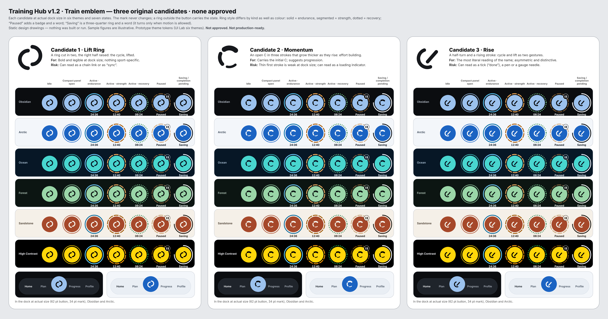 | V01 Emblem — three candidates × six themes × seven states |
| 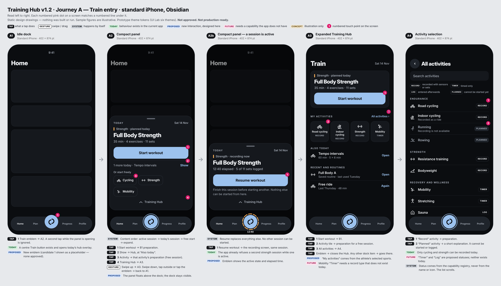 | V02 Journey A — standard iPhone, Obsidian |
| 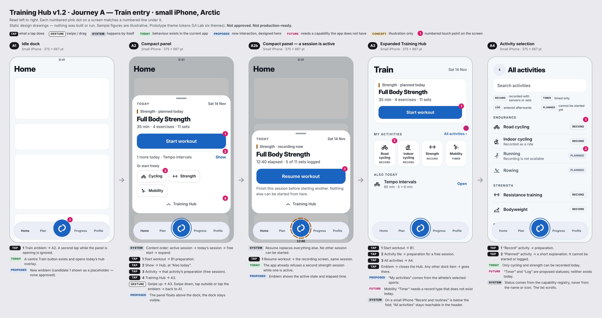 | V03 Journey A — small iPhone, Arctic |
| 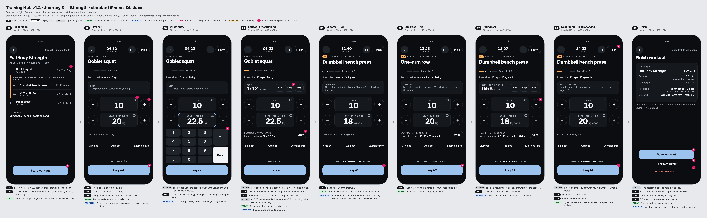 | V04 Journey B — standard, Obsidian |
| 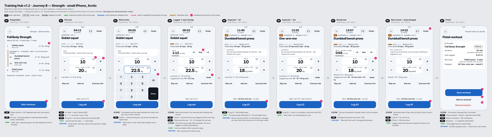 | V05 Journey B — small, Arctic |
| 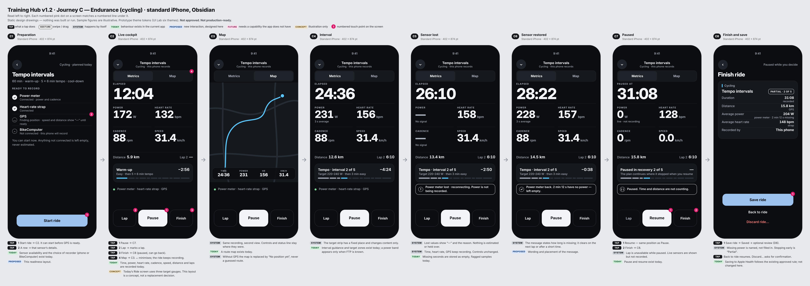 | V06 Journey C — standard, Obsidian |
| 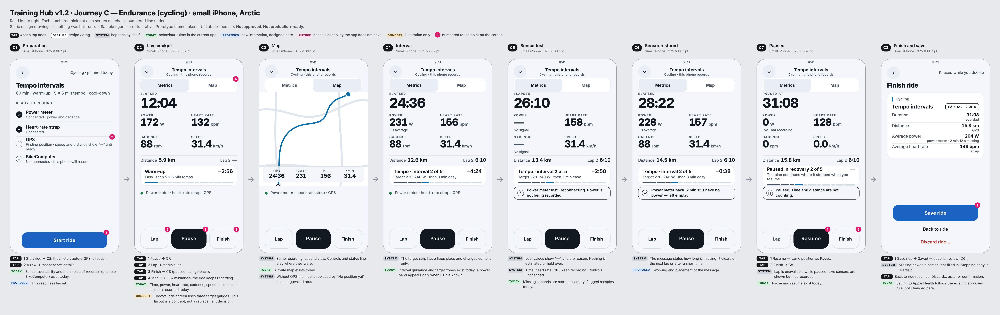 | V07 Journey C — small, Arctic |
| 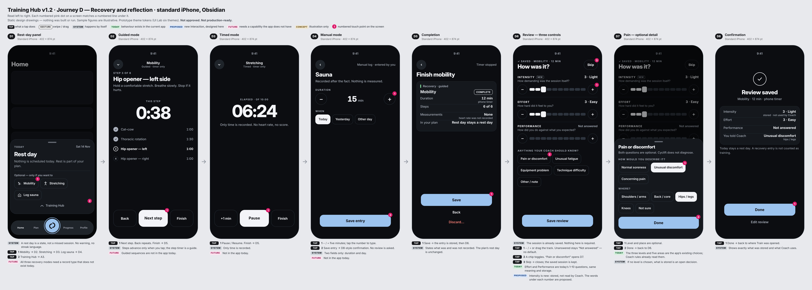 | V08 Journey D — standard, Obsidian |
| 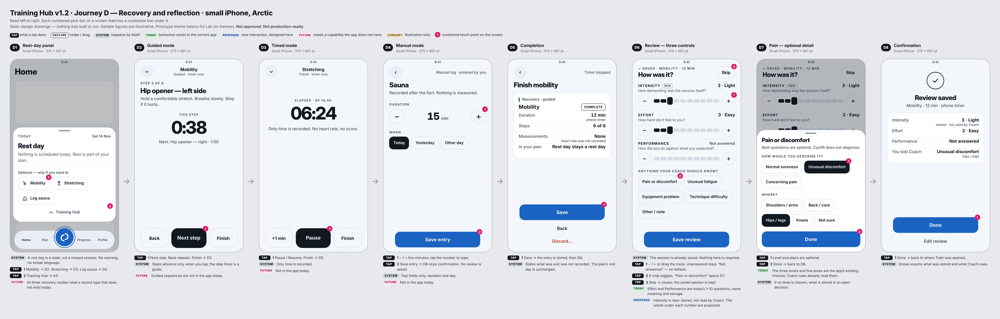 | V09 Journey D — small, Arctic |
| 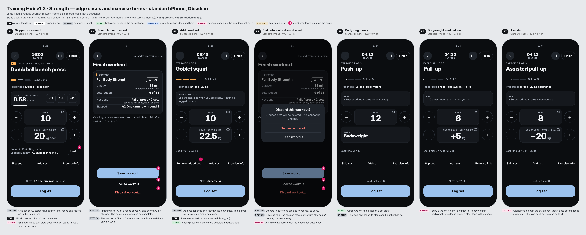 | V10 Strength edge cases and exercise forms |
| 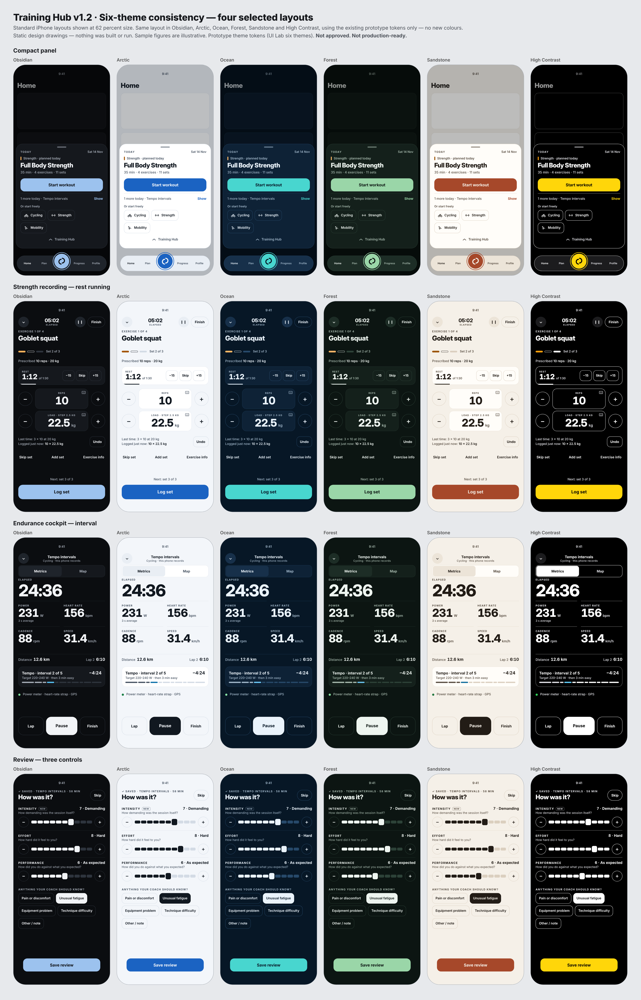 | V11 Six-theme comparison of four layouts |
| 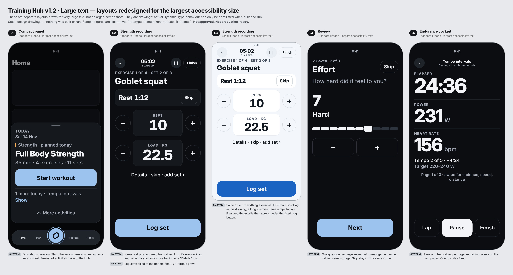 | V12 Large-text layouts |
| 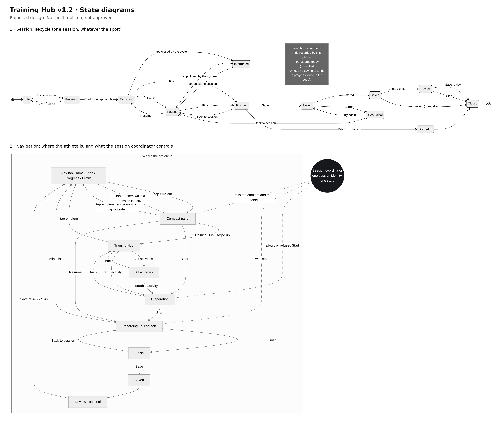 | V13 State diagrams |

## 4. The four journeys

**A — Train entry.** A1 idle dock → A2 compact panel (A2b when a session is active) → A3 Hub → A4 all activities.
**B — Strength.** B1 preparation → B2 first set → B3 direct entry → B4 logged, rest running → B5 superset A1 → B6 A2 → B7 round rest → B8 next round with a changed load → B9 finish.
**C — Endurance (cycling).** C1 readiness → C2 live cockpit → C3 map → C4 interval → C5 sensor lost → C6 sensor restored → C7 paused → C8 finish and save.
**D — Recovery and reflection.** D1 rest-day panel → D2 guided / D3 timed / D4 manual → D5 completion → D6 three-control review → D7 optional pain detail → D8 confirmation.

Under every screen the sheet states what each tap does and marks each behaviour as Today (exists in the app),
Proposed, Future (needs a capability the app lacks) or Concept.

## 5. Train emblem — three candidates, none approved

| Candidate | Idea | For | Risk |
|---|---|---|---|
| 1 Lift Ring | A ring cut in two, right half raised | Bold at dock size | Can read as a chain link or "sync" |
| 2 Momentum | An open C in three strokes that thicken as they rise | Carries the initial; progression | Thin first stroke is weak small; can read as loading |
| 3 Rise | A half-turn and a rising stroke | Most literal "cycle + lift" | Can read as a tick, a pen or a gauge needle |

States (same mark throughout): idle · panel open (thin ring) · endurance (solid ring + time) · strength (segmented ring + time) ·
recovery (dotted ring + time) · paused (faded ring, pause badge, the word) · saving (three-quarter ring, the word).
Ring style differs as well as colour, so the state does not depend on colour alone.
Candidate 1 appears in the journeys **only as a placeholder**.
My own assessment: none of the three is yet as strong as a finished brand mark; they are directions to choose between or reject.

## 6. Strength input — why no dial

The brief allows a dial only as a comparison that shows a real advantage. I could not show one: for a one-step change − / +
is one tap; for a large change typing is about four taps; a dial is slower than both for precision, awkward one-handed and
needs a separate accessible control. It is therefore not drawn. The v1.1 comparison table stays on file.

## 7. Accessibility and small-device review

Checked by measuring the drawings (not a device):

| Check | Result |
|---|---|
| Fixed controls | Log, − / +, value fields, rest area: same position in all strength frames at each size. Lap / Pause / Finish and the target strip: same position in all cockpit frames |
| 44 pt targets | All marked controls ≥ 44 pt in both sizes after correction (the Metrics / Map switch and Undo were below 44 pt in the first pass and were enlarged) |
| Small iPhone (375 × 667) | Every recording, finish and review screen fits without scrolling. Hub and All activities scroll |
| Nothing under dock / keyboard | The panel sits above the dock. The number pad uses the space between the values and Log; Log stays visible |
| Colour-only meaning | Emblem rings differ in style; set markers differ in fill and outline; sensor loss uses "—", a word and an icon |
| Reduce Motion | Panel and Hub appear without sliding; the Saving ring is static; rest shows digits only. Specified, not demonstrated |
| VoiceOver | Specified in the interaction document (labels, values, adjustable controls, grouping). Not testable in a drawing |
| Large text | Five redesigned layouts (V12). At the largest sizes the review becomes one question per page and the cockpit pages its values |

Not verified, and not claimed: real Dynamic Type behaviour, real VoiceOver order, one-handed reach, glare and sweat use,
any physical device.

## 8. Known weaknesses in these drawings (self-review)

1. The cockpit is a new layout; the app's Ride screen today uses three target gauges. Which one Train presents is undecided.
2. Intensity and Effort may not be distinguishable to athletes; untested.
3. The review after a recovery session (Journey D, as the brief specifies) asks "Performance" of a mobility session, which reads oddly.
4. High Contrast: the interval bar's done/current segments are hard to tell apart.
5. A4 on a small iPhone shows only part of the list; statuses on the right may still be taken for buttons.
6. E2 on sheet V10 reuses the Finish screen rather than drawing a distinct mid-round state.
7. Empty space remains in the lower third of the strength screen on the standard iPhone; it is reserved for the number pad.
8. Icons are the v1.1 concept sketches; several are still unclear at small size.

## 9. Decisions requiring the owner

| # | Decision | Options |
|---|---|---|
| 1 | Train emblem | Lift Ring · Momentum · Rise · none — ask for another round |
| 2 | May a recording be minimised to the tabs? | Yes (drawn; the emblem states depend on it) · no |
| 3 | Which live cycling screen does Train present? | Keep today's three-gauge Ride screen · adopt the v1.2 cockpit · decide later |
| 4 | Finish position | Always visible beside Pause (drawn) · only after Pause |
| 5 | Effort no longer asked on Finish: if the review is skipped, no effort is stored and Coach has less to work with | Accept · keep one optional effort tap on Finish |
| 6 | "Not answered" instead of today's pre-filled 7 and 6 | Accept (needs a storage change) · keep defaults |
| 7 | Wording under each number (proposed; must agree with Coach's reference values, effort 6 and performance 7) | Approve · amend |
| 8 | Pain chip with no level chosen — what is stored? | Nothing sent to Coach · stored as "unspecified" (new value) · level required |
| 9 | Review after recovery sessions | Offered after Guided and Timed, never after Manual (drawn) · never · always |
| 10 | Is Intensity worth adding? | Keep as a stored-only field · drop |
| 11 | "Show" for the second session today | Opens the Hub at "Also today" (drawn) · swaps the session inside the panel |
| 12 | Next stage | Further design round · authorise a UI Lab prototype of one journey · stop |
