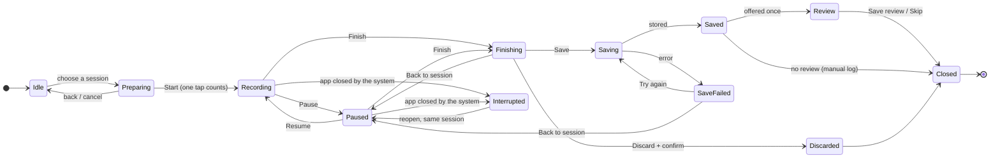

# Training Hub v1.2 — Interaction specification and state diagrams

Status: **Current Draft — pending owner review. Not approved.** · Version 0.1 · 14 Nov 2026 · Level 3
Design only. Nothing was built or run. Source read (read-only): release branch `ios/checkpoint-f-ride`, commit `4e2e9dc`.
"Today" means what the source code does, as read. Reading code is not testing: nothing here was verified on a simulator or a device.

## 1. Navigation audit (before any code is proposed)

| Finding in today's app | Consequence for v1.2 |
|---|---|
| The root screen has five separate presentation owners (train sheet, strength workout sheet, resume full-screen cover, home sheet, hold sheet) plus the Training Hub overlay | v1.2 needs **one logical coordinator** for session identity and transitions. It does not need one sheet, and it does not need a rewrite of navigation |
| The Hub overlay was made animation-free after tap failures (runs 200–206) | A rising panel must be proven against the same failure before it is trusted |
| The shared-presenter repair lives on the UI Lab branch and is unfinished; its last diagnostic run has not been reviewed | It is **not** assumed stable or approved, and v1.2 does not depend on it |
| Strength has one persisted active session; a second start is refused | The coordinator can reuse this rule |
| A ride has its own recorder with its own state (idle, running, paused, ended) and an owner (this phone or the BikeComputer) | Two session mechanisms exist. Whether a ride and a strength session can be active together is **unverified** |
| The Ride screen owns the bottom of the screen during a ride (approved rule RA-01) | A full-screen recording opened from Train, and minimising it, touches this rule — conflict register item 37 |

## 2. Session lifecycle

Rules
- One session at a time. Start is accepted once; further taps during the transition do nothing.
- Entering Finishing pauses the session; "Back to session" returns to Paused with nothing lost.
- A planned item is marked done only by Saved.
- Save failure keeps the record and offers "Try again". Nothing is discarded automatically.
- Discard is a separate, confirmed, destructive choice, never beside Save.
- The review is offered after Saved. Skipping it changes nothing that was saved.

Navigation diagram: sheet V13 and `sheets/navigation.mmd`.

## 3. Interruptions — what is specified, and what is true today

| Event | Specified behaviour | Today, from the code | Verified by test here |
|---|---|---|---|
| App goes to background during a ride | Recording continues; on return the same screen | Location and Bluetooth background modes are declared; a notice is posted; seconds the timer missed are stored as empty flagged samples, not interpolated | No |
| App goes to background during strength | Elapsed time continues from the start time; the rest countdown shows the true remaining time on return | The session is stored with start and pause times; the rest display is computed from the time of the last log | No |
| Phone call | Same as background. The session is **not** paused automatically (proposed; needs an owner view) | No call-specific handling found | No |
| Rest ends while the app is in the background | No sound or notification is promised | No rest notification found in the code | No |
| Sensor lost | Value shows "—" with the reason; other values continue; controls unchanged | Per-measurement source and quality are tracked; samples without a value stay empty | No |
| Sensor restored | Value returns; a message states how long is missing | Not found as a message | No |
| BikeComputer link lost while it is recording | The athlete is never trapped: the ride can be ended on the phone | Implemented (owner decision 7 Nov); duplicates resolved by ride id | No |
| App terminated during strength | Reopen → Paused, same session | The active session is persisted and restored | No |
| App terminated during a ride recorded by this phone | Reopen → Paused, same ride | **No saving of a ride in progress was found in the recorder.** As read, the ride would be lost. This corrects v1.1, which listed it only as "unverified" | No |
| App terminated during a recovery timer | Reopen → Paused | Nothing exists | — |

Protocols of the Waveshare BikeComputer and the LILYGO watch are untouched by this design.

## 4. Compact panel

Order of content: (1) active or paused session → Resume only; (2) today's first planned session → Start;
(3) "n more today" line; (4) the athlete's own activities for a free start; (5) Training Hub.
Rest day: a neutral statement and optional recovery choices; no warning, no streak language.
Opens from the emblem on any tab. Closes by tapping the emblem, tapping outside, or swiping down. Swipe up or "Training Hub" expands.
At the largest text sizes, block 4 moves to the Hub.

## 5. Strength recording

Fixed zones, top to bottom: bar (minimise, elapsed time, pause, Finish) · position and name (two lines reserved) ·
prescription · **rest area (always reserved)** · repetitions · load · reference and Undo · secondary actions · next action · **Log**.

| Control | Behaviour | Today |
|---|---|---|
| − / + | One step: 1 rep; 2.5 kg or 5 lb | Exists |
| Tap a value | Number pad in the space between the values and Log; Done or Log accepts | New |
| Log set | Stores the set, starts rest, shows the next set | Exists (stores, starts rest) |
| Undo | Removes the set just logged, until the next log | Not found in the logging card |
| Rest area | Counts down; −15 / Skip / +15 change this rest only; at zero reads "Rest complete"; never logs or starts a set | Countdown exists; controls are new |
| Skip set | Stores "skipped" | Needs a new state |
| Add set | Appends one set with the last values | Data allows it; control placement is new |
| Finish | Goes to Finishing at any time | Exists (three entry points today; v1.2 has one) |

Supersets: A1 → A2 with no rest unless prescribed → rest after the round → next round.
Today the app already alternates the members of a group and labels them A1, A2 (this corrects v1.1, which said only a
group letter existed). Rounds, round rest and the round counter are **not** in the data model and are proposed.
Edge cases drawn on V10: skipped movement · round left unfinished · additional set · discard · bodyweight only ·
bodyweight plus load · assisted. The last two and "skipped" depend on model changes.

## 6. Endurance recording

One layout with slots filled from the activity's registry entry: elapsed time · up to four live values · distance and lap ·
target strip (fixed place) · status line (fixed place) · Lap / Pause-Resume / Finish (fixed place).
Metrics and Map are two views of one recording. A slot with no source is not drawn; a lost source shows "—" and the reason;
no zeros are invented. Running, rowing, swimming and hiking get a configuration only when a record type and a real source exist;
running cadence and running power are never taken from cycling sensors.

## 7. Recovery

| Mode | What it records | Screen |
|---|---|---|
| Guided | Time, steps completed | Step name, instruction, step timer; advances only on a tap |
| Timed | Time | One timer; Pause, Finish |
| Manual | Duration and day, entered afterwards | Two fields and Save; no review |

A rest day stays a rest day when a recovery entry is saved. No benefit, score or physiological result is stated.

## 8. Finish and review

Finish shows identity, recorded duration, what was completed, Partial or Complete, and what is missing. One primary action: Save.
Review: Intensity (new), Effort and Performance (existing meaning, 1–10). Each has − / + and a draggable track, a number and a word.
Unanswered is shown as "Not answered". Chips: pain or discomfort · unusual fatigue · equipment problem · technique difficulty · other / note.
Pain opens an optional detail using the app's existing three levels and five areas.

## 9. Accessibility specification

- VoiceOver: each value control is one adjustable element ("Repetitions, 10. Swipe up or down to adjust"); the rest area is one
  element with its remaining time; set markers read as "Set 2 of 3, one done"; the emblem reads its state
  ("Train. Strength workout in progress, 12 minutes 40").
- Grouping: bar · position · rest · values · Log, in that order.
- Dynamic Type: layouts on V12; nothing is truncated to fit; the middle scrolls under a fixed Log when needed.
- Reduce Motion: no sliding panel, no turning ring, no animated bar.
- Minimum target 44 pt, measured in the drawings.
