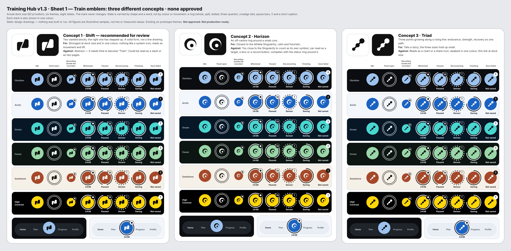
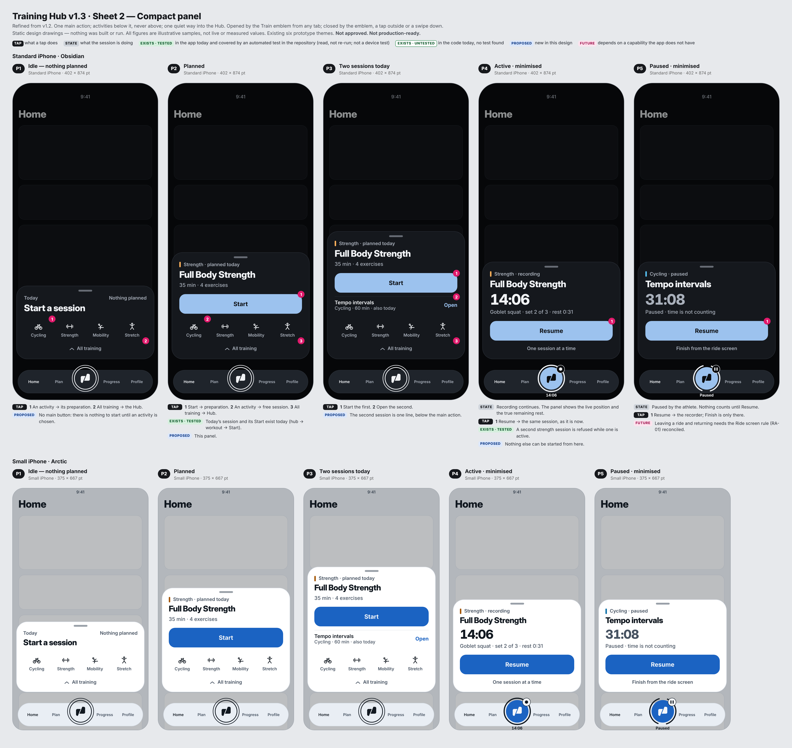
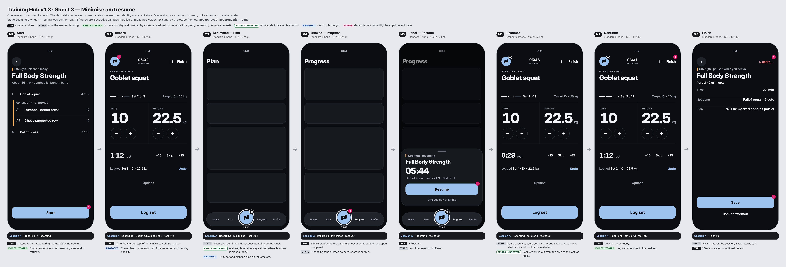
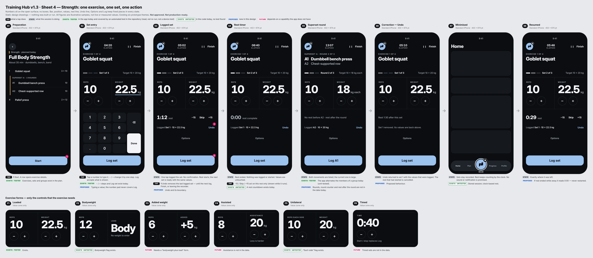
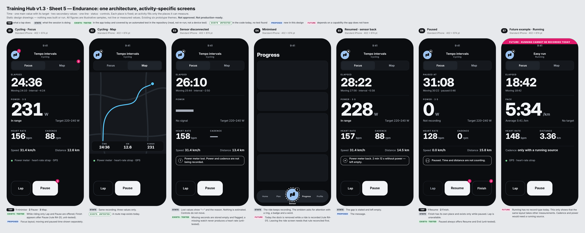
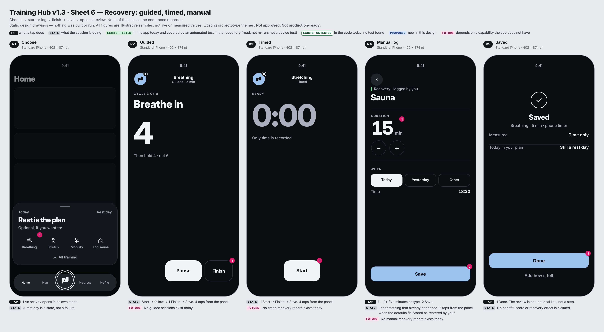
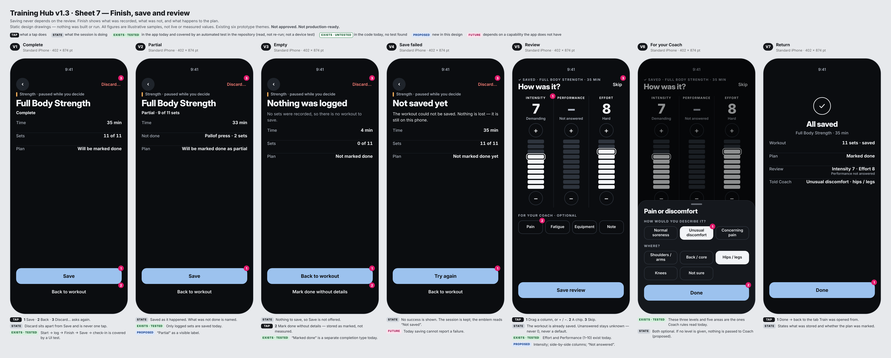
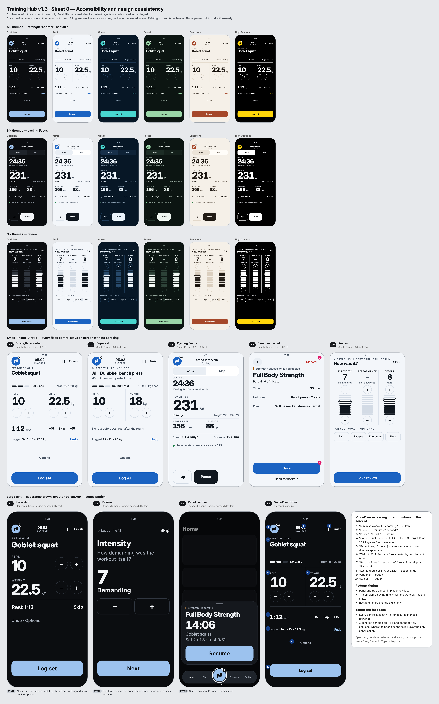
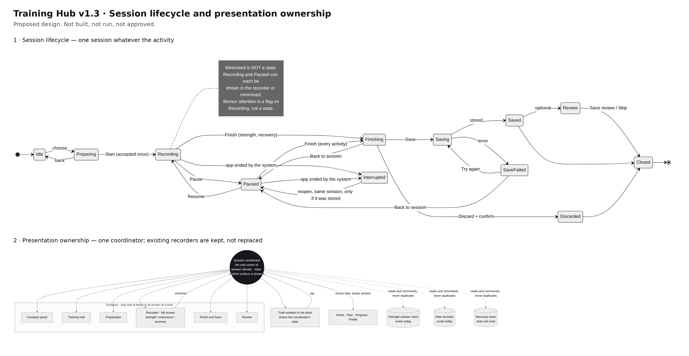

# Training Hub v1.3 — Corrective design: review and mock-ups only

Status: **Current Draft — pending owner review. Nothing here is approved, including every emblem.** · Version 0.1 · 14 Nov 2026 · Level 3
Authorised: design work only. No UI Lab code, production code, onboarding, schema, firmware, Plan, Home, Progress or Coach change was made.
Nothing was built or run. Screens are static drawings; every figure on them is an illustrative sample, not a live or measured value.
Source read (read-only): release branch `ios/checkpoint-f-ride`, commit `4e2e9dc`.
Earlier rounds (v1.0, v1.1, v1.2) stay on file unchanged.

Companions: `TRAINING_HUB_V13_SESSION_ARCHITECTURE.md` · `TRAINING_HUB_V13_DATA_AND_CAPABILITY_CONTRACT.md`.

## 1. Governing decisions (owner, 14 Nov 2026) — applied, not reinterpreted

Balanced experience · compact panel first · dedicated full-screen recording · a distinctive Cyclift emblem ·
**active-session minimisation: approved design direction, Option A**. These are design decisions, not permission to build.

## 2. Labels used on every sheet

| Label | Meaning |
|---|---|
| EXISTS · TESTED | In the app today **and** covered by an automated test in the repository. I read the test; I did not re-run it. It is not a physical-device test |
| EXISTS · UNTESTED | In the code today; no test found |
| PROPOSED | New in this design |
| FUTURE | Depends on a capability the app does not have |

## 3. What changed from v1.2, and what did not

| Changed | How |
|---|---|
| Minimisation | Was an open question; now the centre of the design. Minimising is a change of screen, not a change of session state (sheet 3, architecture document) |
| Emblem | Three new concepts from three different families (solid, orbital, linked points). v1.2's three were all arc drawings. State is now shown by ring shape, a badge and a word — no discipline colour, no dependence on animation |
| The way out of the recorder | The emblem itself sits at the top left of every recorder and minimises it |
| Compact panel | Fewer elements. Nothing above the main action. Activities as a quiet icon row. Five states drawn at two sizes |
| Strength recorder | No boxes round the values. Two large numbers side by side. Rest and Undo are single lines with fixed places. Secondary actions behind one "Options" |
| **Cycling controls — correction of a v1.2 error** | v1.2 drew Finish beside Pause while riding. That contradicted the approved, unit-tested rule RA-20 (End is never reachable while a ride is running; always reachable once paused). v1.3 follows RA-20: riding = Lap and Pause; paused = Resume and Finish, in a place of its own |
| Cycling views | "Focus" (one main value with its target) and "Map", replacing the four-value grid |
| Review | Three side-by-side columns (Intensity · Performance · Effort), drag or + / −, "Not answered" instead of a default |
| Finish | Complete, partial, empty and save-failed drawn separately. Discard moved away from Save |
| Recovery | Fewer steps; manual logging can record something that happened earlier |

Unchanged from v1.2: the session lifecycle; one session at a time; fixed control positions; Save independent of review;
no Effort on Finish; capability statuses; the integration flow; all exclusions.

## 4. Sheets

| Sheet | File |
|---|---|
| 1 Emblem — three concepts, eight states, six themes |  |
| 2 Compact panel — five states, two sizes |  |
| 3 Minimise and resume journey |  |
| 4 Strength, and six exercise forms |  |
| 5 Endurance — Focus, Map, sensor loss, minimised, paused, a future example |  |
| 6 Recovery — guided, timed, manual |  |
| 7 Finish and review |  |
| 8 Accessibility and consistency |  |
| Diagrams |  |

## 5. Emblem — trade-offs and recommendation (none approved)

| Concept | Family | For | Against |
|---|---|---|---|
| **Shift** | Solid: two slanted blocks, the right one stepped up | Strongest at dock size and in one colour; unlike any system icon; movement and lift without a sport | Abstract; needs time to mean "Train"; can read as a slash |
| Horizon | Orbital: off-centre ring round a core | Closest to the Athlete Singularity | Too close to it to be a symbol of its own; can read as a target or record button; competes with the status ring |
| Triad | Linked points rising | Tells the three-discipline story | Reads as a chart or share icon; weakest in one colour |

**Recommendation for review: Shift.** Reason: it is the only one that stays unmistakable at 34 pt in a single colour and does
not borrow from the Singularity. It is a recommendation, not an approval, and I do not consider any of the three a finished brand mark.

States (same mark throughout): Idle · Panel open (outlined button, thin ring) · Recording (small, in the recorder, with a dot) ·
Minimised (ring, dot, elapsed time) · Paused (split ring, pause bars, "Paused") · Reconnecting (dotted ring, "!", "Sensor") ·
Finishing (three-quarter ring, "Saving") · Save failed (filled "!", "Not saved").

## 6. Taps compared with the app today

Counted from the app's own UI journey test and the root navigation code; v1.3 counted from the drawings.

| Task | Today | v1.3 | Note |
|---|---|---|---|
| Start today's strength workout | 3 (centre → today's workout → Start workout) | 3 (emblem → Start → Start) | No saving; the preparation step is kept on purpose |
| Log a set as prescribed | 1 | 1 | Same |
| Change a weight by a large amount | One tap per 2.5 kg | 1 + digits | Typing is new |
| Return to a strength session in progress | 2 | 2 | Now possible from any tab with the state visible on the emblem |
| Finish → back in the app, skipping the review | About 5 (Finish → Save → check-in skip → Coach screen Done → workout screen Done) | 3 (Finish → Save → Skip) | The Coach screen still appears when Coach has something to show; that adds one |
| Log a past sauna | Not possible | 2 from the panel | Future |
| Start a ride | Not counted — I did not read that flow end to end | 3 | — |

## 7. Accessibility and failure-state checklist

| Item | Status in the drawings |
|---|---|
| Fixed positions for Log, − / +, rest, Undo, Lap / Pause / Finish | Measured identical across all recorder frames at each size |
| 44 pt minimum | Measured on every drawn control, both sizes |
| Small iPhone without scrolling | Recorder, superset, Focus, Finish, Review fit (sheet 8) |
| State never by colour or motion alone | Emblem: shape + badge + word. Sensor loss: "—" + words |
| Large text | Separate layouts drawn (sheet 8); not demonstrated |
| VoiceOver order and adjustable values | Specified (sheet 8); not demonstrated |
| Reduce Motion | Specified; not demonstrated |
| Six themes incl. High Contrast | Three layouts × six themes; existing tokens only |
| Sensor lost / restored | Drawn |
| Save failed | Drawn — FUTURE: today a save cannot report failure |
| Empty session | Drawn |
| Discard | Separate, confirmed, away from Save |
| Second session attempt | Drawn (panel offers Resume only) |
| Interrupted / relaunched | Specified in the architecture document; not drawable as proof |

Known weaknesses of these drawings: the emblem caption slightly overruns the dock on the small iPhone; R3 shows the
recording dot before Start; the recorder leaves unused space on the standard iPhone (reserved for the number pad);
activity icons are still the earlier sketches; Intensity versus Effort is untested with athletes.

## 8. Unresolved decisions

| # | Decision |
|---|---|
| 1 | Emblem: Shift, Horizon, Triad, or another round |
| 2 | Rule RA-01 (the dock is removed while a ride is recorded): change it so a ride can be minimised, or keep rides un-minimisable for now and apply minimisation to strength and recovery first |
| 3 | Which live cycling screen Train presents: today's three-gauge Ride screen, or the Focus / Map concept |
| 4 | Rest-timer policy (architecture document §5): approve or amend |
| 5 | Undo boundary: until the next log, Finish, or leaving the recorder — approve or amend |
| 6 | Coach fallback when the review is skipped and no effort exists (a separate proposal is needed; none is invented here) |
| 7 | Meanings and words for Intensity, Performance, Effort — to be reconciled with Coach's reference values |
| 8 | Pain chip with no level: nothing passed to Coach (proposed), or require a level |
| 9 | Is Intensity kept as a stored-only field |
| 10 | Recovery: is a review offered at all after a manual log (drawn: one optional line) |
| 11 | Next stage: another design round, or authorise a UI Lab prototype of one journey (my suggestion: sheet 3, strength only) |

## 9. Implementation dependencies (nothing started)

One session coordinator · reconciliation of RA-01 · a save that can report failure · storing a phone-recorded ride while it
runs · optional rating values · a recovery record type · rounds, skipped sets, added-weight / assisted / timed set forms ·
direct numeric entry · the capability registry · the emblem artwork.
