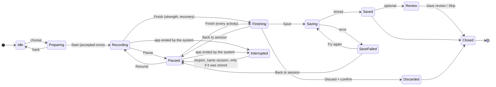

# Training Hub v1.3 — Session architecture: minimise, resume, ownership

Status: **Current Draft — pending owner review. Not approved.** · Version 0.1 · 14 Nov 2026 · Level 3
Design proposal only. No code was written. Source read (read-only): release branch, commit `4e2e9dc`.

**What a drawing cannot prove.** Background recording, behaviour during a call or with the phone locked, recovery after the app
is closed, and save integrity can only be established by building and testing on a real phone. Every row below is labelled:

- **Existing Verified** — in the app and covered by an automated test in the repository (read, not re-run; not a device test)
- **Existing Unverified** — in the code, no test found
- **Proposed** — new behaviour designed here
- **Dependent** — needs a capability that does not exist

## 1. The central idea

Minimising changes **what is on screen**. It does not change **the session**.

| Two separate things | Values |
|---|---|
| Session state | Idle · Preparing · Recording · Paused · Finishing · Saving · Saved · (Save failed) · Review · Closed · Interrupted |
| What is shown | The recorder · or any tab, with the emblem showing the state |

So "Recording + minimised" and "Paused + minimised" are the same sessions as in the recorder, viewed from elsewhere.
"Interrupted" is different: the app or the system stopped, and the screen reports what could actually be recovered.

## 2. Lifecycle

A ride can be finished only from Paused. That is the existing rule RA-20 and it is kept.

## 3. Presentation ownership — one proposal

Today the root screen has several independent owners of what is presented: a train sheet, a strength-workout sheet,
a full-screen resume cover, a home sheet, a hold sheet, and the Training Hub overlay. The Ride screen is a tab of its own.

**Proposal: one session coordinator.** It is a single object that owns three facts and nothing else:
the identity of the active session, its state, and which Train surface is on screen (panel, Hub, preparation, recorder,
finish, review, or none).

| Rule | Purpose |
|---|---|
| Only the coordinator opens or closes a Train surface | No two owners can present at once |
| Only one Train surface is on screen at a time | No stacked sheets |
| Start is accepted once per session; the coordinator ignores Start while a transition is running | No duplicate sessions |
| The coordinator does **not** record. It commands the existing strength session store and the existing ride recorder | No new recording engine |
| The emblem and the panel only read the coordinator | They can never disagree with the recorder |
| Minimise = "show tabs"; Resume = "show recorder" — the engines are not told anything | No timer, sensor subscription or Health workout is created or destroyed by changing screens |

It does not require one SwiftUI sheet or a rewrite of navigation. The unfinished shared-presenter work on the UI Lab
branch is **not** assumed stable and this proposal does not depend on it. Diagram: sheet "W9" and `sheets/presentation_ownership.mmd`.

## 4. Required behaviour, labelled

| Requirement | Strength | Endurance (cycling) | Recovery |
|---|---|---|---|
| Minimising does not pause or finish | Existing Unverified — the session is stored independently of its screen; closing the screen leaves it in progress | **Dependent** — today the dock is removed while a ride is recorded (RA-01), so there is nowhere to go. The recorder itself lives outside the Ride screen | Dependent — nothing exists |
| Data stays with the same session | Existing Verified — a partly logged session survives a restart (unit test) | Existing Unverified while the app stays alive | Dependent |
| Emblem shows an active session | Proposed. (Today the centre button's routing knows a session is in progress) | Proposed | Proposed |
| Train offers Resume first | Existing Unverified — today's hub routes to the session in progress | Proposed | Proposed |
| Resume restores the true current state | Existing Unverified | Existing Unverified | Dependent |
| A second session cannot start | **Existing Verified** — "no second session while one is in progress" (unit test) | Existing Unverified — whether a ride and a strength session can be active together was not established | Dependent |
| No duplicate recorder, timer, Health workout or sensor subscription on tab change | Existing Unverified — tabs stay alive; one store | Existing Unverified — one recorder object for the app; the phone writes a Health workout only at Save; the watch workout starts only on the change into running. Health export "recorded once" is unit-tested | Dependent |

## 5. Timer policy (proposed — needs approval)

| Timer | While minimised, backgrounded or locked | When the session is paused | On return |
|---|---|---|---|
| Elapsed | Runs by the clock | Stops | Shows the true value |
| Rest | Runs by the clock | Stops and keeps its remaining time | Shows what is truly left; **0:00 if it ended while away; never restarted** |
| Interval (ride) | Follows the ride recorder | Stops | True value |
| Guided step | Runs by the clock | Stops | True value |

No sound or notification is promised when a rest ends away from the recorder: none exists today.
Today's rest display is worked out from the time of the last log (Existing Unverified).

Times kept distinct on a ride: elapsed, moving, paused, interval. Showing moving and paused time separately is Proposed.

## 6. Edge cases

| Case | Specified behaviour | Label |
|---|---|---|
| Minimise immediately after Start | Allowed as soon as the state is Recording; the emblem shows it | Proposed |
| Repeated rapid taps on Train | One panel. Taps within a short interval are ignored | Existing Verified for today's hub (a 0.35 s guard and a 48-cycle UI reliability test); Proposed for the new panel |
| Trying to start another session | The panel offers Resume only | Strength: Existing Verified. Other combinations: Existing Unverified / Dependent |
| Returning from another tab | Same session, same state | Strength: Existing Unverified. Ride: Dependent on RA-01 |
| Phone call | Not paused automatically; treated as backgrounding | Existing Unverified — no call-specific handling found |
| Lock and unlock | Recording continues; timers by the clock | Ride: Existing Unverified (background location and Bluetooth modes declared; missed seconds stored empty and flagged — the flagging is unit-tested). Strength: Existing Unverified |
| Background and foreground | As above | As above |
| App ended and relaunched — strength | Reopens paused, same session | Existing Verified for the stored session surviving a restart; the "reopens paused" presentation is Proposed |
| App ended and relaunched — ride recorded by the phone | Should reopen paused | **Dependent** — no saving of a ride in progress was found; as read, the ride is lost |
| App ended and relaunched — ride recorded by the BikeComputer | The device keeps recording; the phone re-adopts | Existing Unverified |
| Permission revoked (location, Bluetooth, Health) | The affected values show "—" with the reason; recording of the rest continues; nothing is invented | Proposed. Related: a missing watch never produces a heart rate — Existing Verified |
| Sensor disconnects and reconnects | "—", then the value returns with the gap stated | Loss handling Existing Verified in part (BikeComputer link loss: pause, resume, end, review — unit test); the messages are Proposed |
| Save fails | "Not saved yet", session kept, Try again; emblem reads "Not saved" | Dependent — today a save cannot report failure |
| Pause while minimised | Not offered. Pause and Finish exist only in the recorder, so there is one place for each | Proposed |
| Finish after minimising | Resume → Finish (ride: Resume → Pause → Finish) | Proposed |

## 7. Risks to weigh before any build

1. **Background execution.** A ride depends on the system keeping the app alive. The modes are declared but nothing here was tested on a phone. A minimised ride raises the stakes because the athlete is no longer looking at it.
2. **Interrupted recording.** A phone-recorded ride is, as read, held only in memory until it ends. Encouraging athletes to leave the ride screen before this is fixed would make silent loss more likely.
3. **Save integrity.** Saving cannot currently fail visibly. "Save failed" is drawn but has nothing underneath it yet.
4. **Two engines.** Strength and rides are owned by different mechanisms. The coordinator must not let both be active unless that is decided deliberately.
5. **RA-01 and RA-20.** Both are approved rules for riding safety. Minimising a ride changes RA-01; nothing in v1.3 changes RA-20.
6. **Presentation.** The app has already had tap failures caused by animated presentation. The panel must appear without moving targets.

Suggested order if a prototype is ever authorised: strength minimise-and-resume first (lowest risk, mostly existing behaviour);
rides only after items 1–3 are settled.
