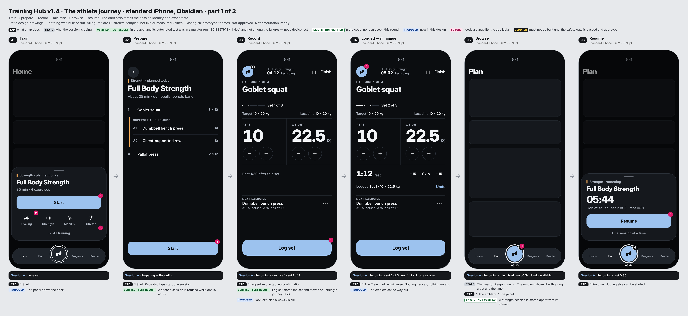
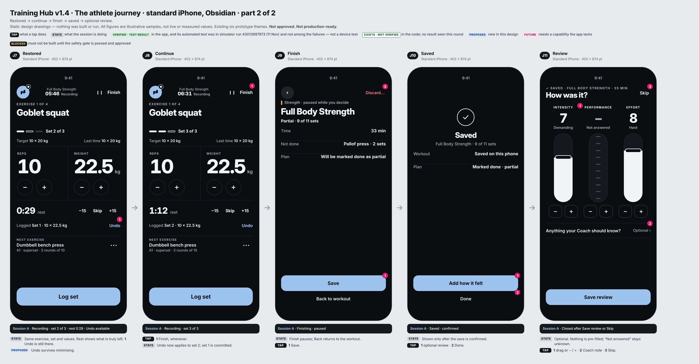
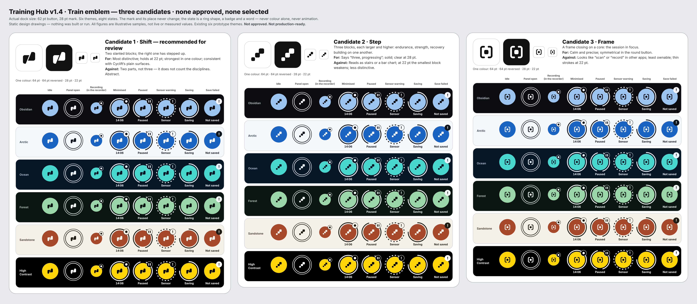
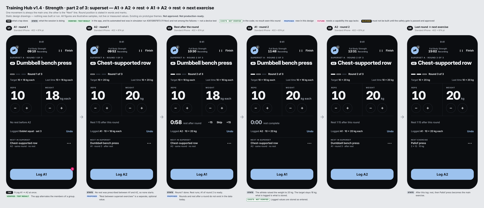
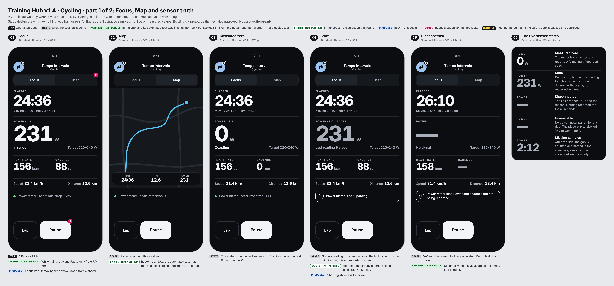
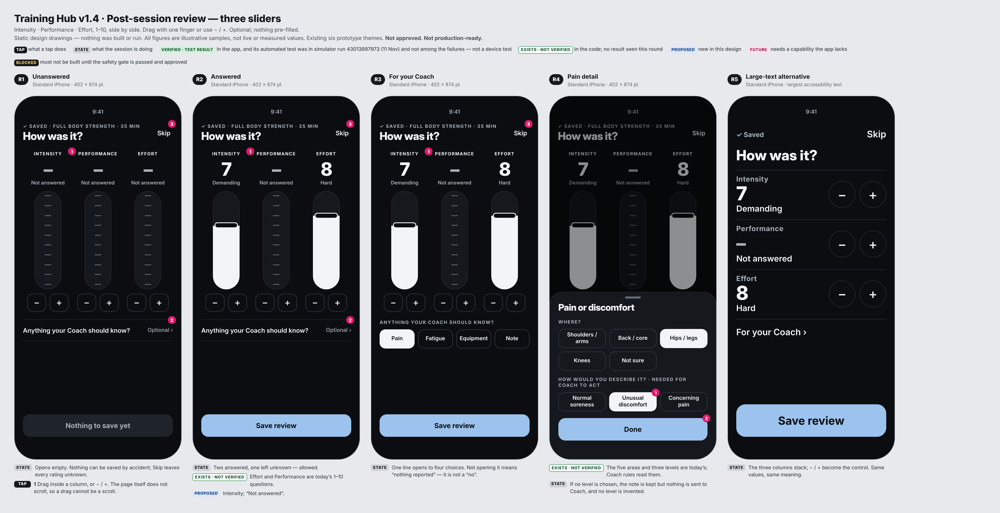
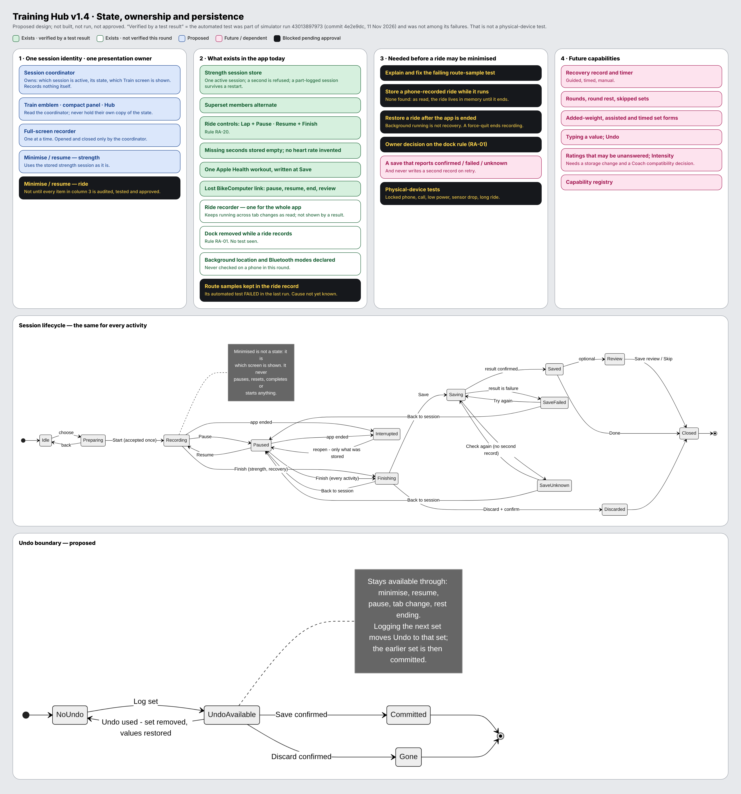

# Training Hub v1.4 — Design and UX architecture baseline

Status: **Current Approved — Design Baseline** (owner approval, 14 Nov 2026). **Implementation is not authorised.** · Version 0.2 · 14 Nov 2026 · Level 2
Approved as design: compact panel then expanded Hub · full-screen recording · one session lifecycle with minimise, resume, finish and save ·
activity-specific endurance screens · strength recording, superset journeys and rest management · recovery concepts ·
optional review (Intensity, Performance, Effort) · the v1.4 visual direction, six themes and accessibility requirements.

**Explicitly pending — not approved, not resolved:**
1. Final Train emblem selection.
2. Cycling minimise / resume safety gate, including GPS recording and storing a ride in progress.
3. Session save-result handling and recovery.
4. Unanswered review values, Intensity storage and Coach compatibility.
5. New exercise and recovery data capabilities.
6. Unresolved session-behaviour and rest-rule decisions.

**Open defects — unchanged by this approval:** the ride GPS-route test and the Plan edit-and-apply test both failed on the
release head (run 43013897973). Neither has been investigated or fixed.

No further Training Hub design round is planned. Every screen in this package is a static drawing; nothing was compiled, run or tested.
No production code, UI Lab code, schema, onboarding, Home, Plan, Progress, Coach, firmware, watch or BikeComputer file was changed.
v1.3 is preserved unchanged as historical documentation (`product/train/v13/`).
Decision record: `decisions/2026-11-14_training-hub-v14-approved-design-baseline.md`.

Companions: `TRAINING_HUB_V14_CYCLING_SAFETY_GATE.md` · `TRAINING_HUB_V14_TECHNICAL_IMPACT.md` · `TRAINING_HUB_V14_ACCEPTANCE_CRITERIA.md`.

## 0. How evidence is labelled in this package

| Label | Meaning |
|---|---|
| Verified · test result | The behaviour is in the app **and** its automated test was part of iOS run **43013897973** (commit `4e2e9dc`, 11 Nov 2026, simulator) and was **not among that run's failures**. I can see the run's failure list, not a per-test pass line. It is not a physical-device test |
| Exists · not verified | In the code as read; no result seen this round |
| Proposed | New in this design |
| Future | Needs a capability the app lacks |
| Blocked | Must not be built until the cycling safety gate is audited, tested and approved |

**Two things the run shows that matter here.** On the release branch head, the unit stage failed on one test —
`RideRegressionTests.testGPSRecordingNeedsNoNetworkAndKeepsRouteSamples` (the ride recorder keeping GPS route samples) —
and the flows stage failed on one Plan edit test. Smoke, journeys (hybrid, cycling, strength), four layout stages and the
watch stage passed. I did not investigate either failure; the ride one is listed as a blocker in the safety gate.

## 1. Design decision ledger

| Kind | Item |
|---|---|
| **Owner approval, 14 Nov 2026** | Training Hub v1.4 is the approved design and UX architecture baseline. Approval does not authorise implementation. Six matters stay pending (see the status block above) and two test failures stay open defects |
| **Owner decision** | 1 — All active workouts can be minimised and restored (Option A). For cycling: an architectural goal behind strict safety gates; current behaviour unchanged |
| **Owner decision** | 2 — Strength shows one primary exercise and the next exercise (Option B) |
| **Owner decision** | 3 — Review uses three side-by-side draggable sliders: Intensity · Performance · Effort; nothing pre-filled |
| Owner decisions carried forward | Balanced experience · compact panel first · full-screen recording · a distinctive Cyclift emblem |
| Preserved from v1.3 | Session lifecycle · one session at a time · emblem as the way out of and back into the recorder · state by shape + badge + word · fixed control positions · Lap + Pause while riding, Resume + Finish when paused · save independent of review · no Effort on Finish · Focus and Map · three recovery modes |
| Proposed corrections (A–H) | See §2 |
| Open questions | See §9 |

## 2. What changes from v1.3

| # | v1.3 | v1.4 | Brief item |
|---|---|---|---|
| A | Sensor loss shown as "—"; a paused ride showed 0 W | Five separate truths: measured zero · stale (dimmed, with age) · disconnected · unavailable · missing samples. Paused readings are labelled live and not recorded; a pause never turns into a zero | A |
| B | Superset drawn as two names on one screen | Full sequence drawn: A1 → A2 → rest → A1 → A2 → rest → next exercise, with the round stated in words and marks; rest rules separated into prescribed, configurable and new logic (§5) | B |
| C | Undo ended on leaving the recorder | Undo survives minimising, pausing and tab changes. It ends at the next log, at a confirmed Save, or at a confirmed Discard (diagram on sheet 08) | C |
| D | Review as three segmented columns with + above and − below | Three true sliders with a large thumb, − / + side by side under each, a non-scrolling page, one collapsed "Anything your Coach should know?" line, and a stacked large-text version | D |
| E | "Saved" and "Not saved yet" | Recorded · pending (Saving) · confirmed (Saved) · failed · unknown — five drawn states; the plan is marked only on confirmed | E |
| F | Shift, Horizon, Triad | Shift (refined), Step, Frame. Horizon removed (too close to the Singularity). Marks drawn at 28 pt in the dock and shown at 22 pt | F |
| G | Ride minimising marked "dependent" | Marked **Blocked**, with a separate ten-point safety-gate document | G |
| H | Large text and small screens mixed on one compressed sheet | The whole journey redrawn at real small-iPhone size; large-text layouts separately drawn; no reduced drawing is offered as proof | H |
| — | Strength recorder: exercise only, "Options" link | Workout name, state, last comparable performance and a fixed "Next" line; options behind one ··· | Decision 2 |
| — | Panel: five states | Seven states, adding rest day and sensor unavailable | §5 of brief |
| — | Evidence label "Exists · tested" from reading test files | Labels based on an actual run result, and the word "tested" is no longer used that way | §14 of brief |
| — | 9 dense sheets | 20 readable sheets, six screens at most per image, in the owner's presentation order | §15 of brief |

Not changed: anything in the "Preserved" row of the ledger.

## 3. Sheets, in presentation order

| # | Sheet | File |
|---|---|---|
| 1 | Athlete journey, standard iPhone, Obsidian | `sheets/01a_…`, `01b_…` |
| 2 | The same journey, small iPhone | `sheets/02a_…`, `02b_…` |
| 3 | Train emblem candidates | `sheets/03_train_emblem_candidates.png` |
| 4 | Strength: ordinary sets · superset · corrections and forms | `sheets/04a_…`, `04b_…`, `04c_…` |
| 5 | Cycling: Focus, Map, sensor states · minimise, restore, pause, finish | `sheets/05a_…`, `05b_…` |
| 6 | Review sliders · compact panel (7 states) · recovery · finish and save (8 states) | `sheets/06a_…` to `06f_…` |
| 7 | Six themes · High Contrast at full size · large text, VoiceOver, Reduce Motion | `sheets/07a_…`, `07b_…`, `07c_…` |
| 8 | State, ownership and persistence | `sheets/08_state_ownership_persistence.png` |

## 4. Emblem — recommendation, not selection

| Candidate | Distinctiveness | Readability at 22–28 pt | Scalability | Consistency with Cyclift | Main risk |
|---|---|---|---|---|---|
| **Shift** — two slanted blocks, one stepped up | High — unlike a system icon | High — two solid shapes | High | High — plain solid surfaces | Two parts, not three; abstract |
| Step — three blocks rising | Medium — close to a chart or stairs | Medium — smallest block weakens at 22 pt | Medium | High | Reads as "statistics" |
| Frame — brackets round a core | Low — common "scan / record" idiom | Medium — thin strokes | High | Medium | Not ownable |

Recommended for review: **Shift**, on those four criteria. It still does not literally show three disciplines; if that
matters more than distinctiveness, Step is the alternative. None is selected, and I would not call any a finished brand mark.

## 5. Strength rules — what is prescribed, what could be configured, what is new

| Rule | Today | v1.4 |
|---|---|---|
| Rest after an ordinary set | Prescribed per exercise (a rest value exists on each exercise). Exists · not verified | Unchanged |
| Rest between superset exercises (A1 → A2) | No separate value | **Configurable (proposed):** none by default |
| Rest after a completed round | No rounds in the data | **New logic:** needs rounds and a round-rest value, or a rule for which exercise's rest applies |
| Order A1 → A2 → A1 … | The app alternates group members. Verified · test result | Unchanged |
| Skipped set or exercise | A set is done or not done | **New logic:** "skipped" as its own state |
| Early finish | Only logged sets are saved. Exists · not verified | Shown as "Partial" (label proposed) |
| Athlete changes a value | Stored as entered; athlete-modified sessions are not rewritten. Verified · test result | Target and logged value shown side by side |
| Units | Stored in kilograms, shown in the athlete's unit | Unchanged |
| Bodyweight | A flag; never a number | Shown as "Body", with no weight control |
| Added weight · assisted · timed | Not representable | Future |

## 6. Review — compatibility in brief (full version in the technical impact document)

Effort and Performance keep their 1–10 meaning. Historical records are not touched. Intensity is new and stored only.
Today the check-in stores both ratings as required numbers and opens pre-filled with 7 and 6; "unanswered" therefore
needs either a rule ("store a review only when both are answered") or a storage change. Neither is made here, and no fallback
or Coach formula is proposed.

Unanswered feedback is different from a negative answer: not opening "Anything your Coach should know?" stores nothing;
it is never recorded as "no pain" or "no fatigue".

## 7. Accessibility review

| Check | Result |
|---|---|
| Fixed positions | Measured in the drawings: Log, − / +, rest, Undo and Next are at identical positions in every strength frame at each size; Pause / Resume, the main value and the status line likewise in every cycling frame |
| 44 pt | Every drawn control measured ≥ 44 pt at both sizes |
| Small iPhone | The full journey drawn at 375 × 667; nothing scrolls except the Hub |
| Large text | Recorder, panel, cycling Focus and review redrawn for the largest size |
| VoiceOver | Reading order and adjustable values specified on sheet 07c |
| High Contrast | Four screens at full size on sheet 07b |
| Reduce Motion | Specified on sheet 07c |

None of these is proof. Dynamic Type, VoiceOver and Reduce Motion can only be shown by a built screen.

## 8. Approval-gate report

**Preserved.** The owner decisions; the lifecycle; one session; the emblem as entry and exit; fixed controls; the riding
control rule; save before review; v1.3 itself.

**Corrected.** Items A–H in §2; the recorder now shows the next exercise; the evidence labels.

**Unverified.** Everything about leaving and returning to a session on a real phone; background and locked-phone recording;
clock-based rest; the dock rule; the ride recorder across tab changes; all accessibility behaviour.

**Cannot be implemented safely yet.** Minimising a ride (all of safety-gate items 2–6 and 10); "Save failed / unknown"
(no save result exists); anything in recovery; rounds, skipped, added-weight, assisted and timed sets; unanswered ratings and Intensity.

**Still needs the owner.** See §9.

## 9. Open choices (carried forward as pending items after the approval of 14 Nov 2026)

1. Emblem: Shift, Step, Frame, or another round.
2. Whether the failing ride test and the failing Plan test on the release head should be investigated now, as a separate task.
3. Dock rule for rides: the smallest change (the Ride screen stays where it is; "minimise" brings the dock back with the emblem state) or moving the ride recorder under Train. Either only after the safety gate.
4. Round rest: which value applies after a superset round.
5. Unanswered ratings: "save only when both are answered" (no storage change) or optional values (storage change).
6. Coach when no effort exists for a session — a separate proposal is needed; none is made here.
7. Words under each rating number.
8. Pain with no level: kept as a note and not sent to Coach (drawn), or a level required.
9. Whether Intensity is kept.
10. Whether a separately scoped prototype may begin, and of what. My suggestion remains the strength journey only.
