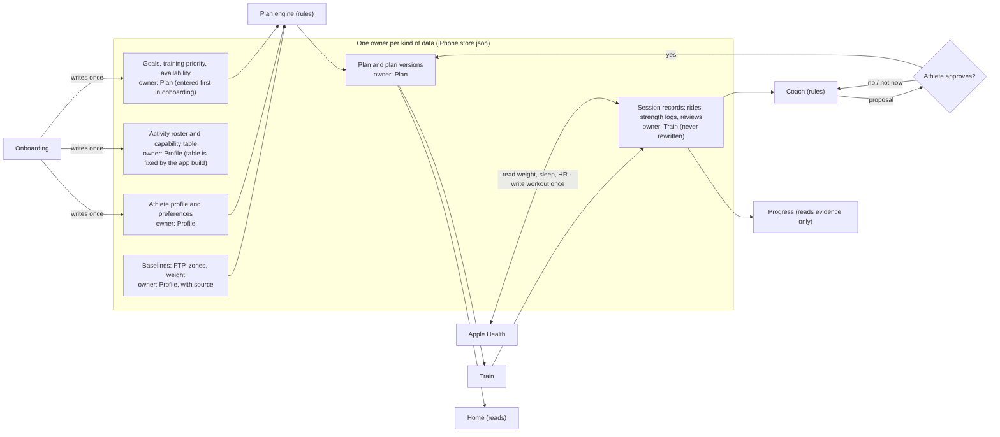
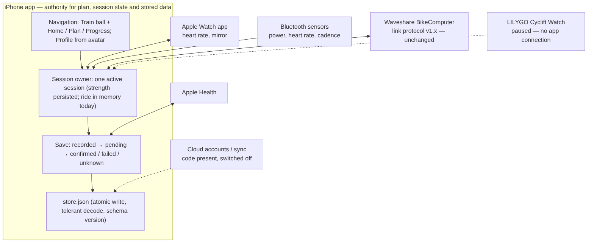

# D — Architecture and Data Integration

**Version:** 0.1 · 15 Nov 2026 · **Status:** Audit and plan — **Pending Owner Approval**. Read-only audit; nothing changed. "Today" = build 216 source (commit `4e2e9dc`), read, not run in this audit.

## 1. Data ownership (target — and where today differs)

| Data | Single owner | Stored (today) | Read by | Today's deviation |
|---|---|---|---|---|
| Name, birth date, weight, units | Profile | profile, settings | Coach, zones | — |
| Activity roster, main sport | Profile | `sports` (read by no engine); main flag **new** | Train, Plan, Progress visibility | athlete type chosen directly |
| Athlete type | derived from roster | `trainingMode` | everything | stored directly |
| Training priority (lead) | Profile (set on onboarding Page 2) | `priority` | planner | — |
| Goals, main goal | Plan | goals, primaryGoal | planner, Progress measure | edited in Profile |
| Availability, session lengths | Plan | availability | planner, Home | edited in Profile; applied without preview |
| Equipment, restrictions | Profile | equipment | strength planner | — |
| Plan, plan versions | Plan | plan, planVersions | Home, Train | Coach path can change it without approval |
| Coach proposals and approvals | Coach | pendingProposals, approvals | Plan | — |
| Rides, strength logs, reviews | Train | rides, strength | Progress, Coach | never rewritten |
| Active strength session | Train | activeSession (saved on change) | navigation | — |
| Active ride | Train | **memory only** | Ride screen | lost on termination |
| FTP, zones | Profile, with source | profile | Train, planner | — |
| Devices | Profile | settings | Train | unverified Cyclift Watch card |
No cloud account or server sync is assumed: the code exists but is switched off in the release.

## 2. Components and devices

Separate workstreams: **iPhone** (this plan) · **Apple Watch** (regression only) · **Waveshare BikeComputer** (protocol untouched; regression only) · **LILYGO Cyclift Watch** (paused; no app change). No firmware is flashed or modified.

## 3. Capability validation — indoor cycling, mountain bike, bodyweight (requested)
| Activity | What the code actually has | Planning | Coaching | Metrics | Verdict |
|---|---|---|---|---|---|
| Road cycling | One ride recorder (GPS speed and route, watch or strap heart rate, power meter, BikeComputer) | yes ("cycling") | yes | cycling metrics | Planned and recorded |
| Indoor cycling | **Only a name** in the `sports` list. No indoor mode: no GPS-free distance, no trainer control. The same recorder runs | no separate planning | none specific | none specific | **Label of the cycling recorder.** Distance and speed need a sensor |
| Mountain bike | **Only a name.** Same recorder | no separate planning | none specific | none specific | **Label of the cycling recorder** |
| Bodyweight | An equipment preset and an exercise loading type inside strength; not a sport in `sports` | as strength with no equipment | as strength | as strength | **A mode of strength**, not an activity of its own |
| Running, swimming, other | Names only | no | no | no | Not supported |
Consequence for the roster: these three are worded "recorded as cycling / as strength", may be chosen as main (your open point), but the planner continues to plan **cycling** and **strength** only. No per-modality planning is promised.

## 4. Journeys — stored values that travel
| # | Journey | Path and values | Works today | Gap |
|---|---|---|---|---|
| 1 | New hybrid athlete | Onboarding → roster (`sports`, main) → `trainingMode=hybrid`, `priority` → goals, primaryGoal → availability → FTP state → (no stage) → approve → `plan` v1 → Home reads plan → Plan → Train starts session by workout id → saves log or ride (closes the planned session) → Progress reads records → Profile edits same fields | Yes with today's five stages (journey test passed run 221) | roster, main flag, Page 6, blueprint |
| 2 | Strength-only | `trainingMode=strength`: no cycling goals, no FTP, no bike devices, lift-only week | Yes (journey passed) | wording still "Cycling/Strength" in places |
| 3 | Endurance | `trainingMode=cycling`; FTP unknown → heart rate/effort targets; sensors add power and cadence; no sensor → value absent | Yes (journey passed) | indoor = same recorder |
| 4 | Existing athlete updates | store.json decoded tolerantly; missing keys take defaults | Mechanism exists | **no fixture test from build 216**; new fields need defaults; `onboardingStage` mapping |
| 5 | Profile change | Edit → validation → preview → approval → apply → undo | Session edits have preview/apply/undo; **Profile week and type edits write directly** | route through proposals; history untouched |
| 6 | Interrupted workout | Strength: activeSession saved on every change; resumes after relaunch. Cycling: recorder in memory; background continues via location mode; termination loses the ride | Strength yes; cycling partial | minimise UI (strength); cycling blocked |
| 7 | Missed session | Shown as missed in Plan summaries | Display only | no Coach proposal path; linked replacement not modelled |
| 8 | Rest and recovery | Rest days are availability states; a mobility plan entry exists | Rest days yes | no recovery log, timer or reminder |
| 9 | Missing data | No HR → no HR values; FTP unknown → no watts; weight missing → unknown; power absent → not shown; empty strength session not saved; unsupported sport → not recordable | Yes by rule (tests exist) | make save failures visible |

## 5. Architecture changes
**Essential for the next TestFlight (M1):** a visible save-result type; migration fixture from build 216; approval gate on every plan increase; correct the two failing tests' causes.
**M2–M3:** capability table (read-only, in the app); main-sport flag; shared roster component for onboarding and Profile; one session owner for navigation; new stage values for onboarding resume.
**Later:** in-progress ride persistence; sport type per session; recovery records; Intensity; metric registry; stage evaluation; theme tokens.
