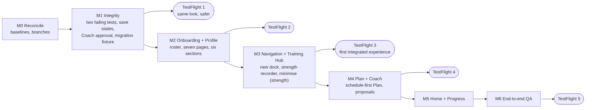

# E — TestFlight Release Plan

**Version:** 0.1 · 15 Nov 2026 · **Status:** Audit and plan — **Pending Owner Approval**. Read-only audit; nothing changed. "Today" = build 216 source (commit `4e2e9dc`), read, not run in this audit.

## 1. Present TestFlight situation (verified records)
| Question | Finding | Evidence |
|---|---|---|
| Latest release-branch commit | `4e2e9dc`, 11 Nov 2026 11:40 UTC, branch `ios/checkpoint-f-ride` | repository |
| Latest fully green iOS run | None since 8 Nov (run 42471078838). Build 216's run had one failing job (flows) and was released under a recorded override | CI run list |
| Latest upload to App Store Connect | **Build 216, version 1.0.0**, commit `fb52ae27`, run 42786480539; "UPLOAD SUCCEEDED", 10 Nov 2026 **10:26 UTC** | `ci-logs: ios/run-216/upload.txt`, summary |
| Latest processed build | Build 216 — "processed (VALID) — installable by internal testers; What to Test set", job finished **10:29 UTC** | `ios/run-216/testflight.txt` |
| Later runs | Five (10–11 Nov), **all failed tests**; release job skipped: "upload: skipped (tests failed)" | runs 42808250299 … 43013897973 |
| Is the pipeline set to upload? | Only when a commit message contains `[testflight]` or a manual run sets upload = true, **and** tests pass | `ios.yml` |
| App commits since 11 Nov | None. Work since has been design documents | repository |
**Diagnosis:** you have not received a build because **none has been produced since build 216**: no upload was requested, the later code fails two tests, and there have been no app changes for four days. Nothing in the records points to a signing, processing or review problem.
**Not verifiable from here:** whether you are still in the internal tester group; whether build 216 is still shown in your TestFlight app (builds expire after 90 days, so it should be); external-testing state. I have no App Store Connect access in this session and the pipeline hides tester addresses. No credential, signing or distribution setting was touched.

## 2. Milestones

Your order is kept. Two adjustments: (a) a TestFlight build after **every** milestone, so each step is small and reversible; (b) Profile stays in its current tab during M2 and moves behind the Home avatar in M3 with the new dock.

| | Scope | Depends on | Likely files | Visible change | Data work | Tests | Acceptance / gate | Rollback |
|---|---|---|---|---|---|---|---|---|
| **M0** | Confirm baselines (C); integration branch from `4e2e9dc`; build-216 store fixture; decide temporary emblem | H approvals | none in app | none | export a fixture | — | Fixture loads in a test | n/a |
| **M1** | Fix causes of the two failing tests; save-result states (model); Coach increases need approval; list and undo protective changes; migration fixture tests | M0 | RideRecorder, SessionChangePreview, AdaptiveStore, Models | Coach increases appear as proposals | one "accepted as of update" baseline | failing tests pass **unmodified**; new approval tests first | full matrix green twice; no plan increase without approval | revert branch; build 216 remains |
| **M2** | Seven-page onboarding with roster; Profile six sections; shared editors; Profile changes through preview | M1; approvals 3, 4 | OnboardingView, OnboardingDraft, ProfileEditors, ProfileSections | New onboarding and Profile | main-sport flag; stage mapping; additive only | journeys ×3 adapted; migration; resume on each page | function map complete; old store identical | feature flag to old onboarding |
| **M3** | Navigation v1.2; Training Hub panel; strength recorder; strength minimise; finish and save UI | M2; approval 2 | ContentView, TrainingHubView, StrengthWorkout | New dock and Train | none | hub reliability; strength journey; minimise/restore; small iPhone | cycling unchanged; no duplicate session | flag to old dock |
| **M4** | Plan Weekly Calendar and Recurring Plan; proposal detail; Move to any day | M3; approval 5 | PlanView, SessionChangePreview | New Plan | linked replacement (if approved) | edit/apply/undo; missed session | Plan spec criteria | flag to old Plan |
| **M5** | Progress hero and sections without stages; Home changes if approved | M4; approvals 6, 7 | ProgressView, HomeView | New Progress | none | lab defects closed first | no stage shown | flag |
| **M6** | Regression, accessibility, persistence, small device, physical-device pass | M5 | — | — | — | whole matrix + device checklist | no critical defect | — |
| **M7** | Release candidate and upload | your explicit go | CI only | — | — | — | your approval | previous build |

## 3. What the first builds contain
| Build | Contains | Does not contain |
|---|---|---|
| **TestFlight 1** (M1) | Same screens as 216; Plan edit works; ride-sample defect closed; increases wait for approval; save failures visible | any redesign |
| **TestFlight 2** (M2) | New onboarding (roster) and Profile | new dock, new Train |
| **TestFlight 3** (M3) | First integrated experience: dock, Train panel, strength recorder with minimise | cycling minimise, recovery, Intensity |
| Deferred | cycling minimise; recovery recording; sport type per session; stage evaluation; six themes; cloud; LILYGO | |
Estimates of duration are not given: none can be supported until M1's diagnostics have been run.
